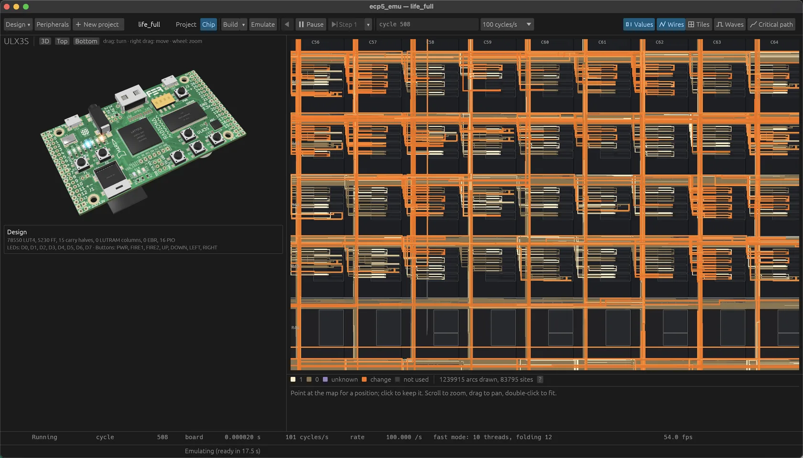
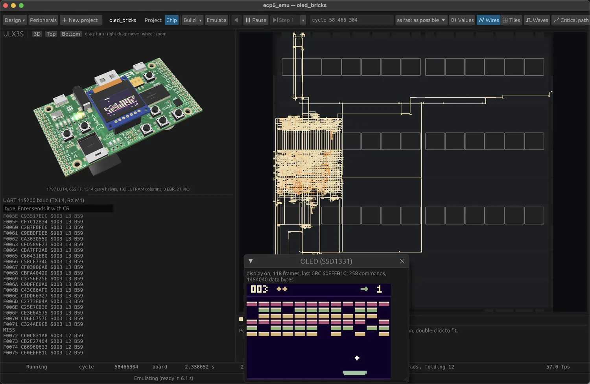
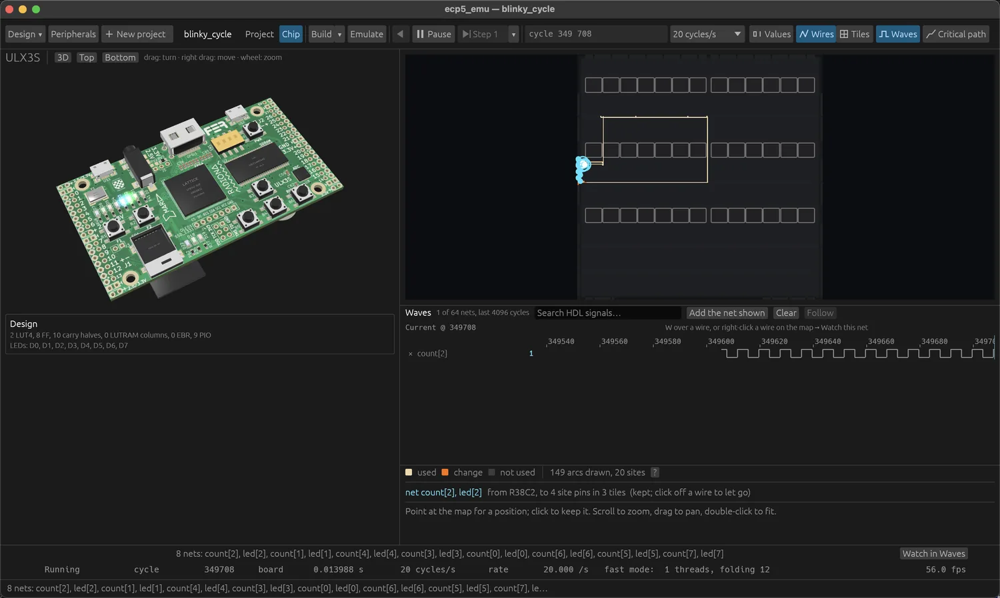

# ecp5_emu

A cycle-accurate digital emulator of the Lattice ECP5 **LFE5U-85F**, for FPGA students and
ULX3S developers who want to see what their HDL built. It runs the real bitstream from
Yosys → nextpnr-ecp5 → ecppack and shows the configured chip running under the design's
signal names ([execution model and scope](site/pages/introduction.md)).

[](site/media/window-life-full.mp4)

## What it does

- Executes the real **LFE5U-85F bitstream**, cycle by cycle, on a structural model of the chip
  ([coverage and board evidence](site/pages/overview.md#what-runs-today)).
- Opens a window with the **chip map, 3D board, Waves and source cross-probing**
  ([window guide and recordings](site/pages/window-guide.md)).
- Creates projects with **New project…** or copies one with **Start from a demo…**
  ([project creation](site/pages/projects.md#creating-a-project)).
- Builds **Verilog, SystemVerilog** (built-in reader or explicit slang) and **VHDL-2008**
  ([languages and checked examples](site/pages/projects.md#languages)).
- Compiles the configured fabric to **C for fast mode**, checked against the event kernel
  ([executor checks](site/pages/verification.md#executor-equivalence), [measurements](site/pages/overview.md#measured-numbers)).
- Models **HDMI, OLED, SDRAM, SD, flash, ADC, RTC, switches and audio** from the FPGA pads
  ([peripherals and their limits](site/pages/overview.md#what-runs-today)).
- Runs **PicoRV32 and SERV** soft CPUs, including the gallery's shell computers
  ([demos](site/pages/getting-started.md#quick-start)).
- Is checked against a **real ULX3S**, with configurations and raw records retained
  ([physical evidence](site/pages/verification.md#physical-ulx3s-evidence)).

[](site/media/oled-bricks.mp4)

*[Orchard (`oled_bricks`)](examples/gallery/oled_bricks/README.md) plays itself on the live OLED, shown on the 3D board and in the OLED panel.*

## Status and limits

Coverage is partial; unsupported modes are refused, and fast mode has additional restrictions.
Timing is digital: no wire/gate delays, metastability or wake-up input settling. Differential
I/O is digital only; audio models open-circuit voltages with no playback
([coverage](site/pages/overview.md#what-runs-today), [limits and toolchain pitfalls](site/pages/getting-started.md#known-limitations), [verification](site/pages/verification.md)).

VHDL projects cannot mix Verilog/SystemVerilog roots. The code's source-probing message is:
"Source probing is not available for VHDL yet: the GHDL plugin writes no source locations"
([language limits](site/pages/projects.md#languages)).

[v0.1.0 is published](https://github.com/r-a-y-z-e-r/ecp5_emu/releases/tag/v0.1.0) for **macOS arm64 and Linux x86-64**.
The macOS app is ad hoc signed, not notarized; Gatekeeper may block the first open.
See [package status](site/pages/getting-started.md#packages-and-release-status) for Linux runtime/graphics requirements and macOS first-open steps.

## Install

Download the matching [package](site/pages/getting-started.md#packages-and-release-status)
from [GitHub Releases](https://github.com/r-a-y-z-e-r/ecp5_emu/releases). It bundles **Yosys, nextpnr,
Project Trellis tools, GHDL/slang plugins and a C compiler (Zig)**, plus the database, image reader,
tour and board model ([contents and launch instructions](site/pages/getting-started.md#packages-and-release-status)).

For a source build, first install the [toolchain and pinned database](docs/TOOLCHAIN.md).
You need Rust **1.92.0** (rustup installs the pin), Yosys/nextpnr/ecppack, clang (or `ECP5_CLANG`),
and the native Trellis reader; `load` also needs openFPGALoader. Slang/VHDL need OSS CAD Suite.
Run these from the checkout root ([full requirements](site/pages/getting-started.md#requirements)):

```sh
git lfs pull
bash packaging/build_trellis.sh
bash packaging/build_test_fixtures.sh
cargo build --release --locked -p ecp5_emu -p ecp5_gui
```

## Quick start

1. Open `ECP5 Emu.app` on macOS, `bin/ecp5_gui` in the Linux package, or
   `target/release/ecp5_gui` after a source build ([launch instructions](site/pages/getting-started.md#packages-and-release-status)).
2. Click **Take the tour** for the guided `blinky_cycle` project
   ([tour and CLI commands](site/pages/getting-started.md#quick-start)).
3. Choose **New project…**, select resources and click **Create** to open the project,
   then **Build** and **Emulate**
   ([creation options](site/pages/projects.md#in-the-window)).
4. Choose **Start from a demo…** to copy a demo, then **Build** and **Emulate**
   ([demo workflow](site/pages/projects.md#in-the-window)).



## Documentation

- [Getting started](site/pages/getting-started.md) — packages, requirements, commands and limits.
- [The window](site/pages/window-guide.md) — chip map, board, Waves, source probing and recordings.
- [Projects](site/pages/projects.md) — creation, HDL languages, builds and board loading.
- [What it does in detail](site/pages/overview.md) — coverage, peripherals and measured numbers.
- [Architecture](site/pages/architecture.md) — execution model and repository layout.
- [Verification](site/pages/verification.md) — software checks and physical-board evidence.
- [Tests](site/pages/tests.md) — prerequisites, opt-in groups and per-area measured times.
- [Related work](site/pages/related-work.md) — bitstream tools, die viewers and virtual boards.
- [Acknowledgements](site/pages/acknowledgements.md) — project credits and build tools.
- [Documentation site](site/README.md) — build and browse the complete technical records.

## How this was built

This project was developed with AI: Claude Code (Anthropic), OpenAI Codex and Google Gemini wrote
the implementation, tests and documentation, and ran the design reviews. Project direction,
technical decisions, playtesting and hardware validation remained human-guided, with comparisons
performed on a real ULX3S board.

## Acknowledgements

This emulator exists because of the following open projects.

- [Yosys (YosysHQ)](https://github.com/YosysHQ/yosys) — synthesises the Verilog designs.
- [nextpnr / nextpnr-ecp5 (YosysHQ)](https://github.com/YosysHQ/nextpnr) — places and routes designs; supplies the window's routed JSON and timing reports.
- [Project Trellis (YosysHQ)](https://github.com/YosysHQ/prjtrellis) — documents ECP5 bitstreams; supplies the image reader's libtrellis, ecppack/ecpbram and the hash-checked [prjtrellis-db](https://github.com/YosysHQ/prjtrellis-db) database.
- [Radiona / ULX3S](https://radiona.org/ulx3s/) — provides the open [KiCad board design and photos](https://github.com/emard/ulx3s) behind board wiring, the 3D model and visual checks.
- [EMARD's ULX3S constraints](https://github.com/emard/ulx3s/blob/v3.0.8/doc/constraints/ulx3s_v20.lpf) — provide the pin constraints the examples derive from.
- [PicoRV32](https://github.com/YosysHQ/picorv32) — Claire Xenia Wolf's soft CPU runs in the console and gallery computers.
- [SERV](https://github.com/olofk/serv) — Olof Kindgren's bit-serial core runs `serv_shell`.
- [OSS CAD Suite](https://github.com/YosysHQ/oss-cad-suite-build) — supplies the pinned binary toolchain for CI and the install guide.
- [openFPGALoader](https://github.com/trabucayre/openFPGALoader) — loads the ULX3S SRAM.
- [egui and eframe](https://github.com/emilk/egui) — provide the window's controls and application framework.
- [wgpu](https://github.com/gfx-rs/wgpu) — draws the die map and board on the GPU.
- [Zig](https://ziglang.org/) — supplies the C compiler bundled for fast mode.

<details>
<summary>More projects we thank</summary>

- [winit](https://github.com/rust-windowing/winit) — provides native windows and input events.
- [Rust and its crates](https://github.com/rust-lang/rust) — provide the compiler, standard library and dependencies; full crate credits are in the packages' `THIRD_PARTY_NOTICES.txt`.
- [Inter](https://github.com/rsms/inter) — supplies the 3D board's chip markings.
- [Ubuntu font](https://design.ubuntu.com/font) — supplies proportional text bundled by egui.
- [Hack](https://github.com/source-foundry/Hack) — supplies monospace text bundled by egui.
- [Noto Emoji](https://github.com/googlefonts/noto-emoji) — supplies emoji glyphs bundled by egui.
- [emoji-icon-font](https://github.com/jslegers/emoji-icon-font) — supplies additional glyphs bundled by egui.
- [KiCad](https://www.kicad.org/) — exports the board layers through `kicad-cli`.
- [Blender](https://www.blender.org/) — builds and exports the 3D ULX3S model.
- [librsvg](https://gitlab.gnome.org/GNOME/librsvg) — rasterises board layers and the icon through `rsvg-convert`.
- [Boost](https://github.com/boostorg/boost) — supplies C++ libraries used by libtrellis.
- [Clang / LLVM](https://clang.llvm.org/) — compiles fast-mode C and the native image reader.
- [Verilator](https://www.veripool.org/verilator/) — runs the gallery's RTL reference simulations.
- [Icarus Verilog](https://steveicarus.github.io/iverilog/) — runs FIR response checks and the DSP reproducer; supplies PicoRV32 reference traces.
- [Pillow](https://python-pillow.org/) — composites board textures and visual QA sheets.
- [NumPy](https://numpy.org/) — processes board texture arrays and rendering calculations.
- [mdBook](https://github.com/rust-lang/mdBook) — builds the documentation site and supplies its theme assets.
- [GHDL](https://github.com/ghdl/ghdl) and its [Yosys plugin](https://github.com/ghdl/ghdl-yosys-plugin) — synthesise VHDL-2008 projects.
- [slang / yosys-slang](https://github.com/povik/yosys-slang) — supplies the explicitly selected SystemVerilog frontend.
- [Python](https://www.python.org/) — runs the build, packaging, research and reference-check scripts.
- [CMake](https://cmake.org/) — configures the native Trellis library build.
- [Ninja](https://ninja-build.org/) — runs the native library build when selected by the packaging helper.
- [Open Sans](https://github.com/googlefonts/opensans) — is bundled as a documentation theme font.
- [Source Code Pro](https://github.com/adobe-fonts/source-code-pro) — is bundled as a documentation code font.
- [highlight.js](https://github.com/highlightjs/highlight.js) — highlights documentation code blocks.
- [Font Awesome](https://github.com/FortAwesome/Font-Awesome) — supplies documentation theme icons.
- [clipboard.js](https://github.com/zenorocha/clipboard.js) — supplies documentation copy controls.
- [mark.js](https://github.com/julkue/mark.js) — highlights matches in documentation searches.
- [elasticlunr.js](https://github.com/weixsong/elasticlunr.js) — supplies the documentation's client-side search.
- [Ace](https://github.com/ajaxorg/ace) — is bundled for editable documentation code blocks.
- [Ayu](https://github.com/dempfi/ayu) — supplies a documentation colour theme.
- [Tomorrow Night](https://github.com/chriskempson/tomorrow-theme) — supplies documentation syntax colours.
- [color-themes-for-highlightjs](https://github.com/jmblog/color-themes-for-highlightjs) — supplies documentation syntax colour themes.
- [Base16](https://github.com/chriskempson/base16) — supplies documentation syntax colour themes.

</details>

See [licenses/README.md](licenses/README.md) for licences and evidence.

## License

The code is licensed under the Apache License, Version 2.0 ([LICENSE](LICENSE)). Third-party
material keeps its own licences, listed in [licenses/README.md](licenses/README.md). Release
packages carry `LICENSE` and `THIRD_PARTY_NOTICES.txt`.
