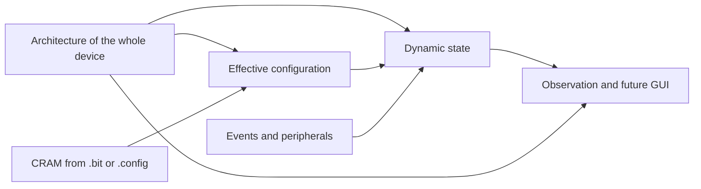

# Structural model of the full ECP5

The current code is extended by [automatic construction of the execution plan](AUTOMATIC_EXECUTION.md), [LUTRAM/RAMW](LUTRAM_EXECUTION.md), and [global controls with explicit wake phases](SYSTEM_EXECUTION.md). Native MODE/SD, directed paths, LUT/FF/CCU2/PIO, and the shared RAM state are tied to GSR/GOE/GWDIS; the virtual `sys:` items add no physical BELs. The remaining lines of this document keep the general specification and the history of the first milestones.

Status: a specification with a partial implementation. The Rust `DeviceModel` loads all tiles, the resource catalog, sites, packages, and the directed route descriptions; [CORE_STATUS.md](CORE_STATUS.md) describes the first milestone. After it came [ConfigurationImage, ConfiguredDevice, and DeviceState](CONFIGURATION_STATE.md), then [event-driven LUT/FF execution](EVENT_KERNEL.md) with explicitly specified connections. The full graph of internal nodes and the automatic mode interpretation are still ahead.

## Three linked layers

The device architecture is permanent: tiles, functional resources, internal nodes, ports, wires, directed connections, and configuration bits exist independently of the loaded user design. The configuration selects modes and connections. The dynamic state holds wire values, memory, registers, and pending events.

The GUI reads the same objects and events that the kernel uses. Changing the zoom, hiding inactive resources, and the animation speed do not change the emulation.

## Objects and identity

| Object | Identity and content |
|---|---|
| Device | Family, density, variant, revision of the architecture data; the package is stored as a separate profile |
| Tile | Full name with the type, and the CRAM window; tiles with the same row/col remain distinct objects |
| Resource | A permanent architecture instance and its parent hierarchy; can be linked to several tiles |
| Node | An internal LUT, mux, arithmetic node, register, memory array, or resource state machine |
| Port | Owner, direction, width, and a per-bit link to wires or internal nodes |
| Wire | Canonical Trellis name with its coordinate space and the preserved source aliases |
| Connection | Source, sink, direction, kind, control bits, or a constant condition |
| Storage | The single owner of physical state; modes and ports can have different views of the same bits |
| ConfigField | Applicable bits, inversions, decoding variants, mode conditions, and source references |
| SiteReference | The source tile record and a separate relation to an object, including candidates and unknown links |
| PackagePin | A package pin, a PIO, or a special function; availability in the package does not remove the internal resource |

The research catalog uses readable IDs of the form `LFE5U-85F/R11C0/PIOA`. For internal objects, the path continues with the node name: for example, `…/SLICE_A/LUT0`. The internal node names are so far project-defined. Dense numeric indexes for speed are assigned separately and do not become the external identity. The final profile must also pin the version of the ID scheme and of the data.

The coordinates of a tile, of a BEL anchor, of a source site record, and the on-screen position are separate fields. The architectural grid does not contain the exact shape of the metallization. Unverified geometry is not passed off as a reconstructed physical layout.

## Connections and clock networks

Directed fixed connections, buffers, and the variants of programmable muxes are stored as separate objects. A disabled connection stays in the architecture with its configuration state. The pseudo-connections for permuting LUT inputs, which Trellis adds for placement, are marked as tooling and do not become physical switches.

Only proven aliases of one conductor can be merged into an electrical node. A directed buffer and a programmable path must not be turned into an unconditional bidirectional connection. Conflicts among several drivers are resolved while preserving the origin of the drivers and the `0/1/X/Z` states.

Even Trellis's `fixed_conn` needs an architectural interpretation. The descriptions of all eight ECLKSYNCs have a fixed input → output path alongside a mode setting and a STOP port. Until the mode is checked, such an arc cannot automatically become an unconditional conductor in the executable model. The source arc, the interpreted physical path, and the evidence for its condition must be stored separately. The cases are collected in the [description of the clock resources](CLOCK_SYSTEM_RESOURCES.md#obstacle-to-literal-execution-of-the-trellis-graph).

MID, the central muxes, DCC/DCS, SPINE, TAP_DRIVE, and local branches keep their boundaries. Wires with the G prefix use the global namespace; the position of a functional block does not automatically move all of its ports there. The central DCCs need independent instances even when the Trellis BEL constructor does not create them.

In DSP, 306 nodes per block with fixed sources and programmable inputs were also found, including JMULTA, JCFB, and output bypasses. The additional descriptions of PRADD9/18, MULT9/18, and ALU24/54 may define alternative views of the common structure. For them the source records are kept together with the status of the required mode interpretation; 24 boundary namespaces are not yet bound to site labels. The information and the paths are collected in [DSP_ROUTING.md](DSP_ROUTING.md).

The executable graph may be reduced and compiled for speed. Every computed value must keep its link to architecture objects; internal states hidden by optimization must be recoverable for observation. Removing an unused area from the main model is not allowed.

## Shared configuration and shared state

Configuration owners cannot be derived only from the tile's site list. For one resource, all CRAM fragments, shared bits, and interpretation modes are collected. The source field record and the normalized effective value are stored separately. Matching bit patterns keep the possible ambiguity; unknown bits remain accessible.

One physical register or memory array has one storage. The 9/18-bit arithmetic modes, the use of the shared DSP output register, the EBR width change, and LUTRAM are described as views of this state. The specific mapping of bits to views must be confirmed by a source, not invented from similar primitive names.

[EBR addressing](EBR_ADDRESSING.md) defines six views of the shared 2 048×9 image. At widths 1/2/4 the ninth bits are preserved even though they are not reachable through that port; the low address pins in the wide modes can set write masks. The overlap of accesses is determined through the shared array, not by the equality of address numbers. The PDP36 output and the exact collision rules remain open; the order in which the code processes ports does not decide the winner of simultaneous writes.

The [EBR control analysis](EBR_CONTROL.md) confirms the need to keep the native OUTREG apart from the fabric FFs after the memory. In the checked design with an extra 18-bit pipeline on each port, Yosys left 36 external FFs and NOREG on the EBR. A synchronous output reset during a continuing write also required external logic. The behavior of the source HDL is not assigned wholly to one resource; the reconstructed configuration and the actual connections are used. Unknown hardware transitions are kept until the [board checks](HARDWARE_VALIDATION.md).

The [PLC/LUTRAM structure](PLC_LUTRAM.md) defines the shared A/B/C mode: four LUT memory columns and the RAMW function that overlaps the combinational nodes of C. The LUT and SRAM state is not created as two independent arrays; the original configuration snapshot is kept separately from the current data. Whole SLICEs and split COMB/FF are alternative interfaces. The pseudo-links for LUT permutation belong to the router and add no physical connections to the model. The carry and output mux settings need a joint interpretation of the shared bits.

The catalog already separates the source field record from the composite resource field. For words it additionally stores the logical bit index and the CRAM constraints of each fragment: for example, WID of EBR3 is distributed between two tiles. An empty group is neither a separate physical bit nor a proven constant. Shared bits of several resources are kept with all owners; the fact that a control bit belongs to several primitives does not by itself determine the owner of a register. Details are in the [EBR/DSP description](MEMORY_DSP_RESOURCES.md).

Preliminary DSP hierarchy: group → two slices → pre-adders, multipliers, ALUs, muxes, cascades, and shared storages. The mapping of internal registers to configuration fields and lanes is still open. The current MULT18 and ALU54 catalog defines the placement of interfaces, not the independence of all their internal states.

In IOLOGIC, the 7:1 mode uses the DDR registers of both pins of an A/B or C/D pair. The shared pair must stay a separate link of the structure; the seven-bit interface on A/C does not create an independent second bank on B/D. The input FIFO of the memory mode and the pointers from DQSBUFM are also part of the state. The [IOLOGIC analysis](IOLOGIC_RESOURCES.md) keeps these requirements and the open questions about phases and ownership; the number of physical FFs, given the existing interfaces, has not been established yet.

The [IO path map](IO_ROUTING.md) confirms the shared 7:1 input and output lines and the mode-dependent views of the direct/delayed output. The dedicated DQS/ECLK need group/bank membership relations in addition to ordinary route records. The source local wires keep their own IDs; the relation to the source of the dedicated network does not replace the missing physical chain with a fictitious set of segments. Such parts need an explicit mark of incomplete topology.

[DQS/DDRDLL control](DQS_CONTROL.md) adds requirements for the representation of the DDRDEL delay code and for the owners of pointers and FIFOs. A single DDRDEL port does not define its internal format; an ordinary logic level for it is not yet justified. MEM_SYNC belongs to the loaded fabric logic and adds neither a new hardware BEL nor an automatic startup sequence. The pointer encoding and the internal stages remain unknown and are not given invented physical registers.

## Observation and execution

The new collection [CLOCK_NETWORK.md](CLOCK_NETWORK.md) defines the raw→segment relations of HPBX/VPTX/HPRX and the separate programmable SPINE/TAP. They cannot be replaced by a single node based on the common prefix G_. [PIO_BANKS.md](PIO_BANKS.md) adds joint decoding of BASE_TYPE, the banks, and separate external supply/reference values. [PACKAGE_JTAG.md](PACKAGE_JTAG.md) separates the die pad, the ball, and the board connection.

[SYSTEM_STARTUP.md](SYSTEM_STARTUP.md) requires a separate ConfigurationImage/controller state: CRAM/EBR INIT do not preserve CTRL0/CTRL1/SED/USERCODE or the command order of the current text round-trip. The architecture model, the applied configuration, the environment, and the current states remain different layers. The order of further implementation and the verification criteria are refined in [IMPLEMENTATION_PLAN.md](IMPLEMENTATION_PLAN.md).

States are addressed through an object and its port, a node, or a storage. An observer receives an initial snapshot and the subsequent changes with virtual time. The propagation animation uses the real digital events of the model; decorative motion along a wire adds no extra delay in the kernel.

The event kernel distinguishes virtual time, the delta cycle, and the capture/publish phases of the state. The checked contract for simultaneous edges and local reset is defined in [EVENT_KERNEL.md](EVENT_KERNEL.md). PLL/DLL transitions, system startup, and the remaining families still need to be connected and need their own checks.

A resource model that is not executed has an explicit status and a diagnostic source. It is not silently turned into a wire, a constant, or a skipped block. The policy for running configurations with unsupported active resources must be defined before the family is integrated.

## What changes relative to the prototype

| Prototype part | Decision for further work |
|---|---|
| Reading .config and the bridge to libtrellis | The shared CRAM and the equivalence of inputs were checked on a composite EBR/DSP/INIT example; the [first decoder](CONFIG_DECODER.md) does not yet cover all families |
| bits.db catalogs | Use as source descriptions; add bit owners and interpretation conditions |
| Merging selected arcs into nets | Revise: a permanent architecture needs directions and all the disabled variants |
| LUT/CCU2/FF and 0/1/X/Z | Treat as candidates for the compute functions; separate the structure and the state from the implementation |
| Step-by-step supply of a single clock cycle | Replace with a common event scheduler after the time specification |
| Placement and observation | Build on permanent IDs and the resource hierarchy; do not add a GUI yet |

The criterion for moving on to implementing this structure: the remaining object classes and the storage format are described, there are reference integrity checks, and the candidates are explained or their limits are explicitly kept. The first version of this specification records the decisions but does not close stage 2.
