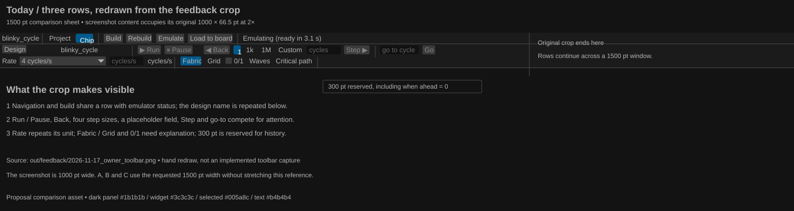
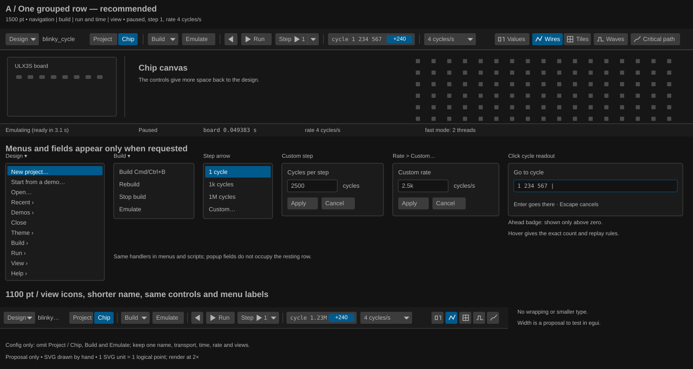
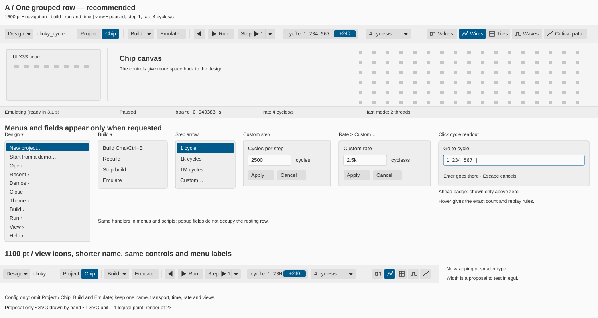
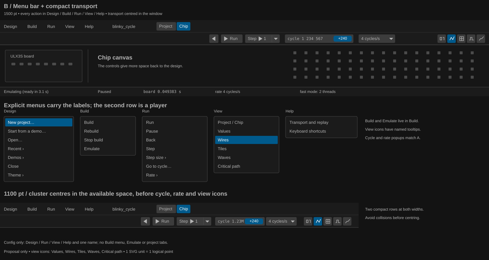
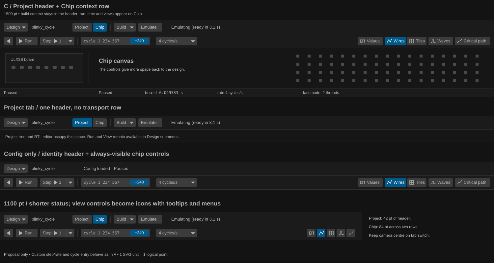

# Project and chip toolbar

Status: **proposal, design only; no code yet**. The drawings specify an interaction
and width budget, not a measured egui implementation. No window was opened for
this note. Source references describe the working tree inspected on 2026-11-17;
line numbers may move as the GUI changes.

## 1. The problem

The button panel needs a redesign. Reference:
`out/feedback/2026-11-17_owner_toolbar.png`, 2000 × 133 physical pixels at 2×
(1000 × 66.5 logical points). Do not mistake that crop for a 2000 pt toolbar.



| Reported problem | What the code says |
| --- | --- |
| Three dense rows mix navigation, build, transport, rate and views. | ProjectApp draws `project_bar`, then delegates to App on Chip (`gui/src/project.rs:1353`, `:1453`). App draws two horizontal rows in `controls` (`gui/src/app.rs:2084`, `:2169`). Project alone does not show all three rows. |
| Design name twice. | Project name at `gui/src/project.rs:1356`; App's 200 pt title beside Design at `gui/src/app.rs:2087`. |
| Two adjacent “cycles/s”. | Custom rate hint at `gui/src/app.rs:2211`, followed by a unit label at `:2218`, even when Custom is not selected (`:2207`). The preset has its own unit too. |
| Disabled placeholder inputs take width. | Step input is always laid out, enabled only for Custom (`gui/src/app.rs:2127`). Go-to is always laid out (`:2149`), but **is enabled when ready and paused** (`:2156`); it is not permanently disabled. |
| Step size is separate; Back is far from Step. | Back, four size selectors, input, then Step (`gui/src/app.rs:2108`, `:2115`, `:2129`, `:2139`). |
| “0/1” is cryptic. | Tooltip explicitly says value colouring of wires, LUTs and flip-flops (`gui/src/app.rs:2232`). |
| Fabric / Grid are unclear. | Fabric shows wires and sites; Grid shows tiles/sites without wires (`gui/src/app.rs:2227`). Rename the presentations **Wires / Tiles**, preserving their meaning. |
| Empty space reserved for recorded history. | A 300 pt label is allocated even at ahead = 0 (`gui/src/app.rs:2243`, `:2244`). |
| Load to board is being removed. | Present in the inspected tree, including Retry (`gui/src/project.rs:1428`, `:1440`), and project script `load` (`gui/src/project/script.rs:148`). Removal was the incoming flow decision at the time. Hardware uses `ecp5_emu load PROJECT_DIR` (`src/command_flow.rs:58`). (Since then, Load to board, Retry and project script `load` were removed in `2a55d08`; boards load with `ecp5_emu load`.) |
| New project first in Design and on start. | Incoming creation flow: `git show dev:docs/designs/new-project.md`, §§2 and 8. Today's menu starts with Open (`gui/src/app.rs:1165`); it also contains **Close**, beyond the supplied list (`:1182`). |

## 2. Inventory today

**47 inventory entries**, including individual menu choices, passive labels and
conditional controls; this is not a count of simultaneously visible buttons.
Scope is the three toolbar rows and their menus, not the editor, board, map
context menus or bottom telemetry. IDs are used in every migration table below.
`P:` means `ECP5_PROJECT_SCRIPT`, `G:` means `ECP5_GUI_SCRIPT`. Omit each script's
leading delay/time here. “None” means no current equivalent, not an undocumented
command. `view project|chip` is a P command; G `view X Y ZOOM` moves the camera.

| ID | Label / control today | File:line | Script command today | Keyboard today | Menu today |
| --- | --- | --- | --- | --- | --- |
| 01 | Project name | `gui/src/project.rs:1356` | Passive | — | — |
| 02 | Project tab | `gui/src/project.rs:1362` | P: `view project` | — | None |
| 03 | Chip tab | `gui/src/project.rs:1368` | P: `view chip` | — | None |
| 04 | Build | `gui/src/project.rs:1377` | P: `build` | Cmd/Ctrl+B (`:1344`) | None |
| 05 | Rebuild | `gui/src/project.rs:1384` | P: `rebuild` | — | None |
| 06 | Stop (during build) | `gui/src/project.rs:1391` | None | — | None |
| 07 | Emulate | `gui/src/project.rs:1404` | P: `emulate` | — | None |
| 08 | Load to board (since removed in `2a55d08`; boards load with `ecp5_emu load`) | `gui/src/project.rs:1428` | P: `load` (since removed in `2a55d08`) | — | None |
| 09 | Build / emulator status | `gui/src/project.rs:1446` | Passive | — | — |
| 10 | Retry (board load failure; since removed in `2a55d08`; boards load with `ecp5_emu load`) | `gui/src/project.rs:1440` | P: `load` (since removed in `2a55d08`) | — | None |
| 11 | Design | `gui/src/app.rs:1163` | Menu container | — | Design |
| 12 | Open… | `gui/src/app.rs:1165` | G: `open PATH` | — | Design > Open… |
| 13 | Recent | `gui/src/app.rs:1169` | G: `open PATH` for chosen config | — | Design > Recent |
| 14 | Demos | `gui/src/app.rs:1175` | G: `open PATH`; `build-demo NAME` on start only | — | Design > Demos |
| 15 | Close | `gui/src/app.rs:1182` | G: `close` | — | Design > Close |
| 16 | Theme: System | `gui/src/app.rs:1191` | G: `theme system` | — | Design > Theme |
| 17 | Theme: Light | `gui/src/app.rs:1192` | G: `theme light` | — | Design > Theme |
| 18 | Theme: Dark | `gui/src/app.rs:1193` | G: `theme dark` | — | Design > Theme |
| 19 | Design title beside menu | `gui/src/app.rs:2087` | Passive | — | — |
| 20 | ▶ Run | `gui/src/app.rs:2092` | G: `run` | — | None |
| 21 | ⏸ Pause | `gui/src/app.rs:2098` | G: `pause` | — | None |
| 22 | ◀ Back | `gui/src/app.rs:2108` | None | ← (`:2006`) | None |
| 23 | Step size 1 | `gui/src/app.rs:2115` | G: `step 1` executes; does not select | — | None |
| 24 | Step size 1k | `gui/src/app.rs:2115` | G: `step 1000` executes; does not select | — | None |
| 25 | Step size 1M | `gui/src/app.rs:2115` | G: `step 1000000` executes; does not select | — | None |
| 26 | Step size Custom | `gui/src/app.rs:2115` | G: `step N` executes; no popup command | — | None |
| 27 | Custom step “cycles” input | `gui/src/app.rs:2129` | G: `step N` executes | — | None |
| 28 | Step ▶ | `gui/src/app.rs:2139` | G: `step N` | → (`:2007`) | None |
| 29 | “go to cycle” input | `gui/src/app.rs:2149` | None | Enter (`:2160`) | None |
| 30 | Go | `gui/src/app.rs:2162` | None | Same Enter | None |
| 31 | Rate label | `gui/src/app.rs:2171` | Passive | — | — |
| 32 | Rate combo | `gui/src/app.rs:2189` | G: `rate N\|max\|real` | — | Its popup |
| 33 | 1 cycle/s | `gui/src/app.rs:2173` | G: `rate 1` | — | Rate popup |
| 34 | 4 cycles/s | `gui/src/app.rs:2174` | G: `rate 4` | — | Rate popup |
| 35 | 100 cycles/s | `gui/src/app.rs:2175` | G: `rate 100` | — | Rate popup |
| 36 | 10k cycles/s | `gui/src/app.rs:2176` | G: `rate 10000` | — | Rate popup |
| 37 | real time (25 MHz) | `gui/src/app.rs:2177` | G: `rate real` | — | Rate popup |
| 38 | as fast as possible | `gui/src/app.rs:2178` | G: `rate max` | — | Rate popup |
| 39 | Rate Custom | `gui/src/app.rs:2200` | G: `rate N` applies a value | — | Rate popup |
| 40 | Custom rate “cycles/s” input | `gui/src/app.rs:2209` | G: `rate N` | — | None |
| 41 | “cycles/s” unit label | `gui/src/app.rs:2218` | Passive | — | — |
| 42 | Fabric | `gui/src/app.rs:2227` | None (`--grid` is launch configuration, not a script) | — | None |
| 43 | Grid | `gui/src/app.rs:2229` | None | — | None |
| 44 | 0/1 | `gui/src/app.rs:2232` | G: `values on\|off` | — | None |
| 45 | Waves | `gui/src/app.rs:2236` | G: `waves open\|close`; `watch pointed` adds a wire | W over wire (`:2744`), not a Waves toggle | None |
| 46 | Critical path | `gui/src/app.rs:2898` | G: `critical on\|off\|CLOCK` | — | None |
| 47 | N cycles recorded ahead | `gui/src/app.rs:2243` | Passive | — | — |

Script evidence: GUI dispatcher `gui/src/app.rs:1280`, `:1300`, `:1447`, `:1468`,
`:1470`; full script description `gui/src/trace.rs:105`; project parser
`gui/src/project/script.rs:144`. Neither script dispatcher currently implements
Back, Go-to, map mode or Stop build. Do not claim complete script coverage today.

## 3. Principles and common behaviour

- Group by task: **navigation | build | run and time | view**.
- Show the design name once in the toolbar. A uses one adjacent name after
  Design, B uses one in the menu bar, C uses the header name. Long names truncate
  with their full name/path in a tooltip; do not repeat them in the context row.
- No disabled placeholder inputs. A field appears only after Custom… or a click
  on the cycle readout. Unavailable real actions may still be disabled with a reason.
- Keep text on Build, Emulate, Run/Pause and Step. Draw simple vector icons with
  tooltips and accessible names. All compact icons have the same menu label.
- Keep all retained actions in menus and preserve existing script commands.
  Do not make a menu click or a new text label the only automation route.
- Keep ← Back, → Step, W over a wire, Enter in go-to and Cmd/Ctrl+B Build, with
  the current keyboard-focus guards (`gui/src/app.rs:2003`, `:2742`). Creation's
  proposed Cmd/Ctrl+Shift+N belongs to the separate new-project flow.

**Shared menus.** In A and C, Design contains navigation followed by Build, Run,
View and Help submenus; B exposes those five menu headings directly. Navigation
starts **New project…**, **Start from a demo…**, Open…, Recent, Demos, Close;
preserve Theme > System / Light / Dark there. Creation also appears on the start
screen as specified in `dev:docs/designs/new-project.md`, §§2 and 8. These are
incoming actions, not current inventory entries. Project/Chip live in View too.
Build contains Build, Rebuild, Stop build and Emulate. Run contains Run, Pause,
Back, Step, Step size, Go to cycle… and Rate. View contains Values, Wires, Tiles,
Waves and Critical path, including clock selection. Help explains transport,
replay and shortcuts. Build's visible split button executes incremental Build on
its main half; its arrow opens the same build menu. Stop appears there and beside
the bottom progress status while building, without permanently consuming width.

**Transport.** Back and Step use the same selected step. The Step main half runs
it and pauses; its arrow selects 1, 1k, 1M or Custom…. Show the selected amount
in the split button (for example `Step ▶ 1 ▾`) and spell it out in its tooltip:
“Run 1 cycle and pause (→)”; Back: “Back 1 cycle (←)”. Custom… opens a small
labelled numeric popup with one “cycles” unit, Apply and Cancel. Applying changes
the size, not time. Run/Pause is one fixed-width toggle with the applicable label,
not two separate adjacent buttons. Retain readiness, pause and earliest-cycle
restrictions and replay/input semantics; this proposal changes presentation only.

**Time.** `cycle 1 234 567` is a button-like readout; tooltip “Go to cycle…; click
to type, Enter goes there”. Click replaces its text with a focused numeric editor;
Enter commits, Escape cancels. Preserve the existing number parsing and bounds.
Menu Run > Go to cycle… opens the same editor. Reject invalid input beside it,
without seeking or closing it. A small badge on this readout says `+240 ahead`
only when ahead > 0 (the compact drawing uses `+240`, explained on hover). Its tooltip keeps the full replay explanation from
`gui/src/app.rs:2245`. Reserve a bounded slot inside the readout while the badge
exists; truncate huge counts with the exact count on hover, never reserve 300 pt.

**Rate.** One combo shows `4 cycles/s ▾`. Its choices remain 1 cycle/s, 4 cycles/s,
100 cycles/s, 10k cycles/s, real time (25 MHz), as fast as possible, Custom….
Custom opens a numeric popup with one visible “cycles/s” label, no unit hint;
Apply sends the rate. Preserve fractions/suffixes and the existing real/max
semantics. Long current values truncate with a full tooltip. Rate remains editable
while running; it is a target rate, not measured throughput.

**View.** Values means “Colour wires, LUTs and flip-flops by their values: 1
bright, 0 dim tan, unknown grey-violet; changes remain orange”. Wires/Tiles is a
mutually exclusive segmented selector, not two independent toggles. Tooltips:
“Wires and sites of the die” / “Tiles and sites without wires”. Waves retains
its watch controls, W and click-to-seek. Critical path retains its nextpnr estimate,
clock selector and report; its tooltip must not imply measured hardware timing.

## 4. A — one grouped row (recommended)





Design and the single name, Project | Chip, Build ▾ and Emulate form the left
group. Back, Run/Pause and Step form one transport cluster. Cycle and rate follow;
Values, Wires | Tiles, Waves and Critical path sit at the right as icons + labels.
The example is paused, step = 1, rate = 4 cycles/s, with 240 cycles replayable.
Build status moves to the existing bottom status area (`gui/src/app.rs:2248`),
which must also be hosted on Project rather than existing only inside App's Chip
render. Keep detailed build output/messages in the existing project output pane.

At **1500 pt**, the drawing's content ends at x=1472, with a 46 pt toolbar and
13 pt labels. At **1100 pt**, keep one row: shorten the name to 64 pt with a
tooltip, use icon-only view controls (same order and menus), a 152 pt cycle
readout and compact spacing. Abbreviate the compact display to `cycle 1.23M`
with the exact cycle on hover and in the editor, so its badge cannot cover digits.
The drawn compact row ends at x=1080. This is a
budget, to verify with actual fonts/egui padding, long cycle counts and every
state before shipping; below that width move view actions to Design > View
rather than clipping controls or shrinking text.

Discoverability is strongest for the main path: Build → Emulate → Run; Values
and Tiles now explain themselves. A first-time student sees one left-to-right
sequence instead of choosing among three rows. Step size is one click deeper,
go-to depends on a readout affordance, and the compact view icons need tooltips.
Menus supply explicit names; the button-shaped cycle readout must remain visibly
interactive. On Project, keep the one row; transport/view act on the current
emulator and may be unavailable before emulation, with the reason on hover.

| Current IDs / controls | New place in A |
| --- | --- |
| 01, 19: two names | One name after Design; remove the second title. |
| 02–03: Project / Chip | Navigation segment, also Design > View. |
| 04: Build | Build split main half; Design > Build > Build. |
| 05: Rebuild | Build dropdown; Design > Build > Rebuild. |
| 06: Stop | Build dropdown / Design > Build; temporary bottom progress action. |
| 07: Emulate | Build group; Build dropdown / Design > Build. |
| 08, 10: Load / Retry | Removed by flow; hardware loading uses `ecp5_emu load PROJECT_DIR`. |
| 09: status | Bottom status; details in project output. |
| 11: Design | First button, also contains the task submenus. |
| 12–15: Open / Recent / Demos / Close | Design navigation, after incoming creation actions. |
| 16–18: Theme | Design > Theme, same three choices. |
| 20–21: Run / Pause | One state-dependent transport toggle; Design > Run. |
| 22: Back | Immediately beside Run/Step, icon with tooltip; Design > Run. |
| 23–27: 1 / 1k / 1M / Custom / field | Step arrow; Custom… popup; Design > Run > Step size. |
| 28: Step | Split main half next to Back/Run; Design > Run > Step. |
| 29–30: go-to / Go | Click cycle readout, Enter; Design > Run > Go to cycle…. |
| 31: Rate label | Replaced by self-labelled rate combo / tooltip. |
| 32–39: combo and seven rate choices | One combo; Design > Run > Rate mirrors all choices. |
| 40–41: rate field and unit | Custom… popup; unit once, no permanent field. |
| 42–43: Fabric / Grid | Right-hand Wires / Tiles segment; Design > View. |
| 44: 0/1 | Values icon + label; Design > View > Values. |
| 45: Waves | Right-hand icon + label; Design > View > Waves. |
| 46: Critical path | Right-hand icon + label; Design > View > Critical path. |
| 47: recorded ahead | Conditional badge inside cycle readout, exact count on hover. |

**Config without a project.** Remove Project/Chip, Build and Emulate, including
the Build submenu; close the gaps, do not leave disabled project placeholders.
Show the config's short design name once after Design. The same transport, time,
rate and view row reads naturally as a chip viewer. New project… remains first
in Design and transitions through the incoming host flow; it does not invent a
buildable project around the config. Bottom status shows emulator state only.

## 5. B — menu bar and compact transport



Row one has Design, Build, Run, View, Help, one design name and Project | Chip.
Every retained action is in those menus. Row two centres the Back / Run/Pause /
Step cluster in the window, with cycle and rate immediately following; view icons
align right. Build and Emulate are menu actions, not extra toolbar buttons.
Bottom status receives build progress. Step/rate popups and cycle editing are
identical to A. Full labels for the view icons are in View and hover tooltips.

At **1500 pt**, two 38 pt rows use 76 pt; the transport cluster is centred at
x=750 and the last view icon ends at x=1488. At **1100 pt**, keep two rows and
centre the cluster within the space left of the right-hand view icons, rather
than colliding with them: its centre shifts to x=540 in the compact drawing.
Name truncation is confined to row one. Menu widths are small and predictable;
this layout has more room for long cycle values than A but costs another row.

A student sees familiar menu headings and an uncluttered player. Build and
Emulate are less visible than A, and icon-only views are harder to learn without
View/tooltips. The hierarchy scales well for future actions; centring must yield
to non-overlap at narrow widths. On Project, the compact row still controls the
current emulator, as in A; it does not control editor execution separately.

| Current IDs / controls | New place in B |
| --- | --- |
| 01, 19: names | One name in menu bar. |
| 02–03: Project / Chip | Menu-bar segment; View menu. |
| 04: Build | Build > Build, Cmd/Ctrl+B retained. |
| 05: Rebuild | Build > Rebuild. |
| 06: Stop | Build > Stop build; temporary bottom progress action. |
| 07: Emulate | Build > Emulate. |
| 08, 10: Load / Retry | Removed by flow; `ecp5_emu load PROJECT_DIR`. |
| 09: status | Bottom status and existing output details. |
| 11: Design | First menu heading. |
| 12–15: Open / Recent / Demos / Close | Design, following incoming creation actions. |
| 16–18: Theme | Design > Theme. |
| 20–21: Run / Pause | Centred row-two toggle; Run menu. |
| 22: Back | Centred cluster immediately beside Run/Step; Run > Back. |
| 23–27: step choices / field | Step arrow / Custom… popup; Run > Step size. |
| 28: Step | Cluster split main half; Run > Step. |
| 29–30: go-to / Go | Cycle readout after cluster; Run > Go to cycle…. |
| 31: Rate label | Self-labelled combo after cycle. |
| 32–39: combo / choices | Row-two rate combo; Run > Rate. |
| 40–41: custom rate / unit | Custom… popup, one unit. |
| 42–43: Fabric / Grid | Right icons for Wires / Tiles; View menu. |
| 44: 0/1 | Values icon on right; View > Values. |
| 45: Waves | Right icon; View > Waves. |
| 46: Critical path | Right icon; View > Critical path. |
| 47: ahead | Conditional badge on row-two cycle readout. |

**Config without a project.** Menu bar becomes Design, Run, View, Help plus one
config name; omit the Build heading, Build/Emulate items and Project/Chip segment.
The entire transport row is the same. A first-time config user sees a viewer
with no unavailable project operations. Creation remains in Design/start screen.

## 6. C — project header and Chip context row



Row one has Design, the project name once, Project | Chip, Build ▾, Emulate and
status. Row two exists **only on Chip**: transport/cycle/rate on the left and
labelled view controls on the right. Shared menus keep run/view actions reachable
even while Project is selected. This preserves the editor/chip boundary already
present at `gui/src/project.rs:1453`, with a cleaner Chip context row. Unlike A/B,
the compact build status stays in the header; detailed output stays below.

At **1500 pt**, header and context row are 42 pt each (84 pt total on Chip);
context controls end at x=1488. At **1100 pt**, header status truncates first,
with full text in its tooltip/output; the context row keeps its time controls
and uses view icons with menu labels. Project uses just the 42 pt header at
both widths. Switching tabs changes usable canvas height by 42 pt, so camera
centering must be preserved across the resize.

A student editing RTL sees only the build path. Selecting Chip reveals the
player and view vocabulary at the right moment, with more room than A for
teaching labels. The cost is two rows on Chip and controls moving vertically
between contexts; status competes with the header at 1100 pt. Run/view menu
entries and their state must remain identical across tab switches.

| Current IDs / controls | New place in C |
| --- | --- |
| 01, 19: names | One header name, no name in Chip context row. |
| 02–03: Project / Chip | Header segment; Design > View. |
| 04: Build | Header split main half; Design > Build. |
| 05: Rebuild | Header Build arrow; Design > Build. |
| 06: Stop | Build menu; temporary header progress action. |
| 07: Emulate | Header action; Build menu. |
| 08, 10: Load / Retry | Removed by flow; `ecp5_emu load PROJECT_DIR`. |
| 09: status | Header status, details in project output. |
| 11: Design | Header first button and task submenus. |
| 12–15: Open / Recent / Demos / Close | Design navigation after incoming creation actions. |
| 16–18: Theme | Design > Theme. |
| 20–21: Run / Pause | Chip context-row toggle; Design > Run on either tab. |
| 22: Back | Chip context cluster beside Run/Step; Design > Run. |
| 23–27: step sizes / field | Chip Step arrow / Custom… popup; Design > Run > Step size. |
| 28: Step | Chip split main half; Design > Run. |
| 29–30: go-to / Go | Chip cycle readout; Design > Run > Go to cycle…. |
| 31: Rate label | Self-labelled context-row combo. |
| 32–39: combo / choices | Chip rate combo; Design > Run > Rate. |
| 40–41: custom rate / unit | Custom… popup, single unit. |
| 42–43: Fabric / Grid | Right context-row Wires / Tiles; Design > View. |
| 44: 0/1 | Right Values icon + label; Design > View. |
| 45: Waves | Right icon + label; Design > View. |
| 46: Critical path | Right icon + label; Design > View. |
| 47: ahead | Conditional badge on context-row cycle readout. |

**Config without a project.** Use a small identity header with Design and one
config name, then the chip context row always visible; there is no Project tab
to hide it. Build and Emulate, their menu entries and the project segment are
absent. Header status describes config/emulator loading, not a project build.
This costs two rows for a viewer where A needs only one.

## 7. Recommendation

Choose **A**. It returns the most height to the chip while retaining visible
Build, Emulate and Run labels. B is the easiest menu hierarchy to extend but
hides the build path; C is a reasonable editor-first alternative but retains a
two-row Chip header. Confirm A at 1100 pt with actual layout tests before
implementation acceptance; the static width budget is not evidence of fit.

The SVGs are hand-authored vector widgets, not screenshots of implemented code.
Dark uses panel `#1b1b1b`, widget `#3c3c3c`, selected `#005a8c`, text `#b4b4b4`.
The light A drawing uses the same geometry with a light neutral palette and blue
selection. All sheets are 1500 logical units wide; the today crop remains at
1000 pt scale on that sheet. PNGs are rasterized at 2× into ignored
`out/designs/toolbar/{today,a,b,c,a-light}.png` with `/opt/homebrew/bin/rsvg-convert`.

## 8. What does not change

Keep `build`, `rebuild`, `emulate`, `view project|chip` in the project script;
`run`, `pause`, `step N`, `rate N|max|real`, `values on|off`, `waves open|close`,
`critical on|off|CLOCK`, `watch pointed`, `open`, `close`, `build-demo` and `theme`
in the GUI script. Do not rename G `view` when the UI says Wires/Tiles. Step
selection and execution remain distinct. Creation's commands/host transition
belong to the new-project note, not an alternative protocol here.

There are real coverage gaps today. The eventual change should add proposed G
`back N`, `goto N`, `map wires|tiles`, `step-size N`, and P `stop-build`, using
the same handlers as the menus. These names are **proposals, not existing APIs**.
Popup appearance/focus is a layout-test concern; numeric actions must remain
scriptable without driving pixel coordinates. All existing commands keep their
semantics. The original plan kept P `load` compatibility until the project-flow
migration was complete; the toolbar proposal preserved its parser and did not
restore a hardware menu.
(Since then, Load to board, Retry and P `load` were removed in `2a55d08`; boards load with `ecp5_emu load`.)
Board loading remains available through `ecp5_emu load PROJECT_DIR` and is never
automatic.

Keep existing records: `# script <seconds> <command>` (`gui/src/app.rs:1272`),
`# design CONFIG`, `# load ...`, `# critical ...`, Waves/watch/input notes and
per-frame cycle/rate/values fields (`gui/src/trace.rs:8`, `:42`, `:105`). Project
records retain `build ok|failed|cancelled SECONDS errors=N warnings=N`
(`gui/src/project.rs:984`) and `chip ready SECONDS` (`:638`); moving status text
must not change these notes or readiness waits. G notes use `Trace::note`'s `# `
prefix (`gui/src/trace.rs:838`); project records have an elapsed-time prefix
(`gui/src/project/script.rs:60`). Preserve relative display paths and never
restart/truncate either trace when opening a menu or switching tabs.

## 9. Eventual test and record plan

No implementation or runtime pass is claimed here. The current deliverable is
checked by SVG parsing, rasterization, geometry/text inspection and visual review.

Before accepting implementation, use headless egui layout tests at **1500 and
1100 pt**, both dark and light, for Project, Chip and a config-only App. Cover
ready/paused/running/loading/building/error, all rate labels, long names and
cycles, ahead = 0 and large ahead. Assert every interactive rect stays inside
the row and does not overlap; there is no hidden placeholder field or 300 pt
history allocation, one name, and no Build/Emulate in a config-only window.
Assert A stays one row, B two, and C's context row exists only on Chip (always
for config). Verify right alignment and fixed toggle width across Run/Pause.

Drive menus/popups in those headless tests: choose step size without advancing,
execute Step/Back with that size, apply custom rate once, click cycle/Enter and
cancel with Escape, reject invalid input, preserve earliest-cycle bounds, and
confirm keyboard focus suppresses arrows/W while typing. Check menu/toolbar/
script parity and accessible names/tooltips for compact view icons. Preserve
camera centre on C tab switches and keep hidden-chip script processing working.

After implementation, add **one** enabled record entry to the publication batch,
not one entry per button/layout. Proposed entry (referenced scripts must be
implemented before enabling; do not run this entry before implementation):

```json
{
  "label": "v010_toolbar",
  "project": "examples/ulx3s/blinky_cycle",
  "script": "tools/gui_scripts/v010/toolbar.window.script",
  "project_script": "tools/gui_scripts/v010/toolbar.project.script",
  "timeout": 180,
  "criteria": [
    {"check": "layout"},
    {"check": "note", "source": "project", "pattern": "build ok .*errors=0", "min": 1},
    {"check": "note", "source": "project", "pattern": "chip ready ", "min": 1},
    {"check": "note", "source": "window", "pattern": "^# script\\s+.*\\s+size 1100 ", "min": 1},
    {"check": "note", "source": "window", "pattern": "^# script\\s+.*\\s+theme light", "min": 1},
    {"check": "no_home"},
    {"check": "no_error"}
  ]
}
```

The project script builds, emulates, visits both tabs and waits for readiness;
the window script exercises paused/run/step/back/go-to, presets/custom rate,
Values, Wires/Tiles, Waves and Critical path, resizes 1500 → 1100 → 1500 and
switches dark/light before quitting. Include ahead > 0 after Back. Missing
commands above must land first; use completion conditions, not guessed loading
delays. Record checks establish command/readiness/resize coverage, not popup
appearance or toolbar fit; headless geometry tests supply that evidence.

Use the existing batch runner's dry-run and validation/check workflow, one screen
lock, paired window/project records and normal exit criterion. Output will be
`out/records/v010_toolbar.tsv`, `.project.tsv` and `.out`; add one measured entry
to `docs/WINDOW.md` for the whole batch after capture. Follow the existing visibility/timing rules in
`tools/window_record/README.md`; an obscured/asleep capture is not timing evidence.
