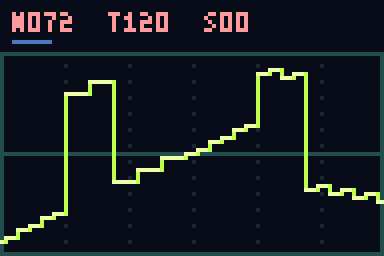
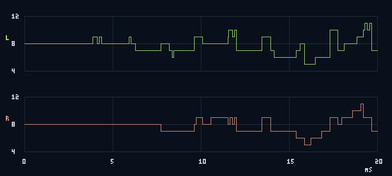

# chip_synth: Glass Orchard

An original four-bar synthesizer in plain RTL, playing through the ULX3S audio
jack while a 96 × 64 SSD1331 OLED draws the most recent full-resolution
left-channel mix samples, before DAC quantisation and clamping.
Three sequenced instruments leave a fourth voice for six live keys. There is no
CPU, firmware, downloaded melody, image, font or sound asset. Everything uses one
25 MHz clock domain, with no PLL and no DIP-switch ports or reads.

On hardware the resistor DAC drives the jack, where headphones let you hear the
music. In the emulator window, **Audio (jack)** shows the modelled voltages,
frequency and Vpp of the DAC output; the OLED shows the internal mix scope.
The window has **no audio playback**.




## Sample and instrument definition

In the independent [Python model](sim/model.py), a sample is
one L/R pair every **1,000 clocks, exactly 25 kHz**. All phase, envelope, sequencer,
history and display state starts at zero, except DAC codes start at 8 and
CRC accumulators start at FFFFFFFF. Samples are numbered from
zero after each restart. On each sample, in this order:

1. Compute the full-resolution mix from the **old** phases and envelopes;
   append the signed raw L mix to history. Quantise and clamp the DAC pair, then
   fold the two zero-extended code bytes, L then R, into the CRC.
2. Advance each unsigned **24-bit wrapping phase** by its current increment.
   When `sample_number % 16 == 0`, advance all four envelopes as defined below.
3. If the sequencer was not paused at the beginning of this sample, handle its
   note-on/off events and advance its eighth-note sample counter. Note-on resets
   that voice's phase and envelope to zero, sets its increment and enters attack,
   overriding this sample's phase/envelope advance. A rest enters release.
4. Advance the live voice's gate timer; then apply any accepted live key, which
   resets voice 3 as a note-on, sets its gate timer to 6,250 and updates the note
   indicator. Finally apply `p`, toggling pause for subsequent samples.

`increment = round(440 * 2^((MIDI_note-69)/12) * 2^24 / 25000)`.
The Verilog contains the rounded integer constants for only the used pitches;
Python computes them independently. MIDI 60 means C4. There is no tuning table
shared between the implementation and the model.

| Voice | Purpose | Wave value at `p = phase >> 19` (0..31) | Sustain |
|---|---|---|---|
| 0 | central bass | triangle: `2*p-15` for p<16; otherwise `47-2*p` | 144 |
| 1 | left-weighted lead | 25% pulse: +15 for p<8, otherwise -15 | 128 |
| 2 | right-weighted harmony | saw: `p-16` | 96 |
| 3 | central live voice | the original small sine approximation below | 176 |

Sine values, in phase order:

```text
 0  3  6  8 11 12 14 15 15 15 14 12 11  8  6  3
 0 -3 -6 -8 -11 -12 -14 -15 -15 -15 -14 -12 -11 -8 -6 -3
```

Every envelope is an unsigned eight-bit gain, 0..255, updated at 1,562.5 Hz.
Attack adds 4, saturating at 255 and entering decay if the old gain was >=251.
Decay subtracts 1, entering sustain and setting the sustain value if the old gain
was <=sustain+1. Sustain holds the instrument's value. Release subtracts 2,
clamping at zero; the phase keeps running silently. All states initially release.
Attack is about 41 ms; release from full gain is at most 82 ms.

For each voice, signed `p[v] = wave[v] * gain[v]`. The products are signed
15-bit integers; the weighted sums use signed 18-bit arithmetic. The unsigned
Q0.8 envelope contributes **eight fractional bits which are retained through
the complete sum**; individual voices are no longer rounded down before mixing.

```text
M_L = 2*p0 + 2*p1 + p2 + 2*p3
M_R = 2*p0 + p1 + 2*p2 + 2*p3
L = clamp(8 + floor((M_L + 1024) / 2048), 4, 12)
R = clamp(8 + floor((M_R + 1024) / 2048), 4, 12)
V = 8
```

Adding 1024 then arithmetic-shifting by 11 rounds to the nearest code, with ties
toward positive infinity, including negative inputs. A code step represents 2048
raw mix units. This gives **4× the previous unclipped gain** (about 12 dB digitally),
which used an effective divisor of 8192 plus per-voice truncation. Actual loaded
headphone volume has not been measured.

The implementation prepares each pair during the existing 1,000-clock interval:
waveform/envelope capture, signed product, two-term partial sums, final sum,
rounding and limiting each have their own register boundary. CRC folding has
one registered stage per byte, L then R. All prepared values settle within eight
clocks of the preceding voice-state update, well before the next sample strobe.
The phase/ADSR update order, 25 kHz pad edges, captured raw samples and AUDIO
report clocks are unchanged. ADSR's eight-bit updates and the OLED's one-bit-per-
clock CRC remain short operations; no multiplied voice sum feeds a CRC stage.

The policy is **clamp, rather than reserve unused DAC range for live keys**.
Both channels always remain at the reference design's safe **codes 4..12**;
0..3 and 13..15 never reach L/R. Loud tune peaks and overlapping live notes may
clip at those endpoints, introducing distortion rather than wrapping or producing
unsafe codes. The full-resolution OLED history is captured **before this clamp**.

Measured from exactly the first 200,000 RTL sample pairs (one 8-second loop,
without live keys), and checked against the Python model:

| Channel | Min / max code | Typical peak-to-peak | 5th / 95th percentile code | AC RMS in codes | Samples clamped |
|---|---|---|---|---|---|
| L | 4 / 12 | 6 steps | 4 / 11 | 1.939 | 8,236 / 200,000 (4.1180%) |
| R | 4 / 12 | 4 steps | 5 / 10 | 1.447 | 4,888 / 200,000 (2.4440%) |

**Typical** means the median peak-to-peak span of all 320 non-overlapping 25 ms
windows, including rests and attacks. AC RMS is standard deviation about each
channel's mean; it is a code-domain statistic, not volts or an acoustic level.
The first 20 ms plotted in wave.png already spans **codes 5..11 on both channels**
while attack is still rising. Quiet passages and rests remain smaller.

V is constant mid-scale, with no LFO. The coarse phase tables, hard pulse/saw
edges, four-bit quantisation and intentional limiting give a chip-instrument
timbre; no reconstruction filter or band-limited oscillator is implemented. The
pulse has a DC component; the mixer is not DC-blocked.

## Original tune

**Glass Orchard was composed for this demo.** Four 4/4 bars at **120 BPM**, eight
eighth-note steps per bar, loop every **200,000 samples / 8 seconds**. Its C–Am–F–G
harmonic path supports a rising opening, a lower answer, a higher third-bar arch
and a suspended return. These are newly arranged notes, not an existing melody.
The exact ROM below is decimal MIDI; `0` is a rest. Columns within each group are
successive eighth notes, not simultaneous samples:

| Bar | Bass (triangle) | Lead (pulse) | Harmony (saw) |
|---|---|---|---|
| 1 | 48 0 48 0 55 0 48 0 | 72 76 74 67 69 0 74 76 | 60 0 64 0 67 0 64 0 |
| 2 | 45 0 45 0 52 0 45 0 | 72 69 67 64 67 0 69 74 | 57 0 60 0 64 0 60 0 |
| 3 | 53 0 53 0 60 0 53 0 | 77 76 72 69 72 79 76 0 | 60 0 65 0 69 0 65 0 |
| 4 | 43 0 50 0 55 0 43 0 | 74 67 71 74 79 76 74 0 | 59 0 62 0 67 0 62 0 |

The ROM is addressed by a five-bit step and packs bass/lead/harmony into 24 bits.
At step offset 0 each non-rest starts its instrument; offset 4,687 enters release.
After offset 6,249 the step advances modulo 32. Each instrument retriggers rather
than tying notes. Live note-on sets a 6,250-sample timer; when its old value is
1,563, voice 3 enters release (4,688 samples after onset). `p` freezes the step and
its offset; oscillators, ADSR, audio reports, live gate and OLED continue. Thus a
pause during a held sequence note can sustain it until the sequencer resumes.

## Controls and queues

| Board control | UART key | Live note on voice 3 |
|---|---|---|
| FIRE1 / btn[1] | `a` | C5 / 72 |
| FIRE2 / btn[2] | `s` | D5 / 74 |
| UP / btn[3] | `d` | E5 / 76 |
| DOWN / btn[4] | `f` | F5 / 77 |
| LEFT / btn[5] | `g` | G5 / 79 |
| RIGHT / btn[6] | `h` | A5 / 81 |
| — | `p` | pause/resume sequencer |
| — | `r` | deterministic restart, then `RESTART` |

The six buttons have two synchronizer flip-flops, then **25,000 stable clocks on
both press and release: 1 ms** at 25 MHz. Each press is latched and queued even if
it ends during a fill or UART report; holding does not repeat. At the window's
~1–2 MHz that filter is about 12.5–25 ms in wall time, short enough for normal
clicks. PWR is unused. FIRE2 is a note, not a restart. Simultaneous buttons enter
the queue in button-number order; a simultaneous UART byte has priority.

A 512-entry command FIFO preserves UART bytes and accepted button presses across
restart. Commands are consumed on sample boundaries. A live command waits until
the previous NOTE line has fully transmitted; accepted commands retrigger the
one live voice in order, rather than allocating more voices. Unsupported UART
bytes are consumed without an action. The finite FIFO is intended for interactive
input, not unlimited serial flooding: overflow is a sticky LED7 fault and an
explicit `OVERFLOW` line, never a silent overwrite. LED6 means paused, LED5..1
show the zero-based sequencer step, and LED0 toggles on every sample for pad-level
measurement (12.5 kHz, appearing dim/steady on hardware).

UART is 115200 8N1, 217 clocks/bit, L4 out and M1 in. The line arbiter transmits
each line through its last stop bit; AUDIO, OLED and NOTE reports retain their
payloads until acknowledged. A requested restart stops sample production after
its accepting sample, completes any in-flight OLED fill, and drains every completed
report. Then it resets all synthesis/drawing state, prints the marker with engines
held, and starts the engines after the marker's final stop bit. Partial AUDIO
blocks are reset, as at power-on. Bytes queued behind `r` remain pending. There is
**no RESTART marker at power-on**, and no truncated line at a restart.

## OLED and output protocol

The common 37-byte SSD1331 init from oled_bricks includes `A0 72`; RES# is low for
at least 25,000 clocks. Each frame snapshots **exactly the last 96 signed raw
M_L samples** (3.84 ms), oldest at x=0, newest at x=95. All 16 meaningful bits
are retained, including the eight envelope fractional bits: this is the internal
waveform before 4-bit quantisation and clamping. The absolute worst-case weighted
sum is bounded by 7 × 16 × 255 = 28,560, so signed 16-bit storage is lossless.
Frame 0 snapshots after init. Subsequent
snapshots are spaced **625,000 clocks / 25 ms (40 fps)**. Snapshots also latch the
note, sequencer step and pause state; none changes during a fill.

Every frame sends `15 00 5F 75 00 3F` then 12,288 data bytes, high-byte-first
RGB565. Mode-0 SPI is 6.25 MHz within a byte (four fabric clocks per bit), with
three handshake clocks between bytes. The data fill takes 430,080 clocks. Its
CRC and report finish before the next snapshot under the documented input rate.
The design waits for every frame's printed line before starting another fill.

Original artwork in [render.v](render.v): background 0863, frame/zero-axis 2269,
dotted grid 1946 at x multiples of 16 and y multiples of 4, connected trace BFE9
with EFF4 sample points, and FCD3 text. Within the 48-pixel trace area below
the header, the waveform is **auto-ranged around zero**, not plotted in DAC codes
or volts. A scan during the six SPI window commands finds
`peak = max(abs(M_L))` over the snapshot. Each sample `m` maps to
`height = floor(22 * abs(m) / peak)`; its row is `38-height` for nonnegative
samples and `38+height` for negative samples. With peak zero, the row is 38.
The largest absolute peak therefore reaches exactly 22 pixels from zero;
a balanced bipolar waveform spans **44 vertical pixel steps** of the available
48. The zero line stays at y=38 and the scale changes per frame. An asymmetric
waveform occupies less height on its weaker side, retaining its DC asymmetry.
Silence stays flat. [render.v](render.v)'s `scope_trace_cache` computes all
96 rows **once per frame**, storing six bits per column in a 576-bit distributed
register file. Snapshot read, absolute value and peak comparison are registered
separately; the peak is complete after 98 clocks. A second pipeline separates
the raw read, absolute value, ×22 scaling and five quotient-bit steps. Each
quotient stage uses one 21-bit subtract/borrow selection, then registers its
remainder, quotient, sign and column tag. The final row is cached after clock
202, inside the existing **210-clock** six-command window interval.

During streaming, a registered row lookup looks one column ahead, followed by
registered segment min/max values. The pixel circuit only compares y against
these six-bit values. Decimal conversion and glyph lookup are also registered
during the window commands. No per-pixel multiply or division feeds the byte/CRC
logic. A Verilator assertion rejects a cache that misses the first pixel; there
are no added wait states, SPI clocks or frame clocks.
Column x joins the previous and current sample with a vertical segment, including
both endpoints; column 0 uses itself as its previous sample. This trace preserves
fine waveform detail even when the DAC rounds several samples to the same code,
and also shows unclipped peaks when the DAC is limiting.
The original 3×5 font shows `Nnnn` (last onset MIDI number, or 000 for a sequencer
rest), `T120`, `Sxx` and `P` while paused. A blue 4BD7 strip at y=10 grows ten
pixels per eighth-note position within the bar. Framebuffer pixels are computed
during SPI; waveform storage is two 96×16-bit history/snapshot registers
(3,072 bits), plus the 576-bit row cache, pipeline registers and peak-scan state.

All lines use CRLF:

```text
RESTART
F0000 C1101837A
F0001 C31D5267C
F0002 CE21912E6
F0003 C1EA7B426
F0004 C62E0BFE8
AUDIO 3125 700893B0
```

`AUDIO` comes every **3,125 sample pairs / 125 ms (eight times/second)**. Its CRC
is CRC-32/ISO-HDLC, reflected polynomial EDB88320, initial/final XOR FFFFFFFF,
over L then R **code bytes**, not voltages; each block starts a new CRC while
phases continue. `Fhhhh Chhhhhhhh` gives a modulo-65536 frame number and CRC over
exactly that fill's 12,288 RGB565 data bytes, excluding commands. `NOTE 072 000002A7`, for example, gives a
three-digit MIDI number and the **zero-based sample number of its onset** in
hex; it describes an accepted live trigger, including a retrigger. AUDIO wins
arbitration over OLED, then NOTE; events that coincide are retained.

## Jack and emulator model

The [audio peripheral definition](../../../docs/PERIPHERALS_AUDIO.md) describes
three nominal 3.3 V four-bit resistor ladders (1100, 549, 270, 130 ohms), meeting
the L/R/V jack nets. [top.lpf](top.lpf) copies audio_tone's DAC balls and LPF header
style, adding the gallery UART, OLED and button constraints. There are no DIP
constraints. The schematic has no series coupling capacitor on these nets.

The emulator assumes an **unplugged, open-circuit jack**, computes conductance-
weighted voltages (not simply code/15), and reports about 70.788 ohms source
impedance. Codes 4/8/12 predict 0.865192/1.796938/2.662130 V unloaded; even these
are modelled, not measured. Headphones load the ladder and change the level.
The model does not include that load, driver resistance, filtering, settling,
glitches, noise, an audio device or playback. Actual sound and loaded levels
require a board check and, for voltages, measurement.

Its independent **48 kHz, 2,400-sample scope ring** holds 50 ms of zero-order-held
voltages. Frequency is a hysteretic rising-mean-crossing estimate; Vpp/extrema
cover one emulated second. A polyphonic chord's estimate is not necessarily any
one note's pitch. The CLI emits `peripheral: audio l_hz=… l_vpp=… r_hz=… r_vpp=…
v_hz=… v_vpp=… transitions=…`; the window records `# audio modelled open-circuit …`
when estimates change. Neither a UART CRC nor an OLED trace validates analog
headphone response.

## Reproducible RTL check

```sh
sh examples/gallery/chip_synth/sim/run.sh
```

The script uses Verilator plus **make -j 1**, copying relative source names and
quoting compiler paths so this checkout's spaces work. It does not call `nice`,
build.sh, the emulator, a board or the window. All raw samples, fills, transcripts,
compiler products and debug logs go under repository-root
`target/gallery/chip_synth/sim/` by default. `CHIP_SYNTH_SIM_OUT` selects another
output directory. An alternate output location inside the demo is:

```sh
CHIP_SYNTH_SIM_OUT="$PWD/examples/gallery/chip_synth/.sim-out" \
  sh examples/gallery/chip_synth/sim/run.sh
```

`.sim-out/` is ignored. Only the two documented PNGs and the golden
`expected/uart.txt` are kept with the demo. The first run creates the golden after
all checks; subsequent runs compare it and fail rather than regenerate it.

C++ reads only top-level pads: LED0 supplies the sample strobe, DAC pads supply
the actual codes, and independent UART/SPI decoders check start/stop bits, the
37 init bytes, every six-byte address window, SPI bit periods, complete fill
lengths and every frame CRC against zlib. It also recomputes every AUDIO block
from the pad codes. A completed fill or AUDIO block with no complete UART report
at the end fails loudly. The Python model separately implements the score,
DDS, ADSR and fixed-point mixer above, computing every code and AUDIO CRC without
reading Verilog constants or internal RTL state.

The check window is **25,000,000 clocks**, about one second including the immediate
restart marker. `margin_cycles: 0` keeps the OLED model's last completed fill in
the printed CRC set; a long default margin could end between a fill and its report.
Only `oled` is required by `check.json`. No audio requirement was added to gallery
check.py: a mixed tune has no single expected frequency suitable for the check, and pad/model CRC
agreement is checked in this simulation instead. The gallery's check.py is unchanged.
The jack model's 48 kHz voltage trace still shows the quantised/clamped DAC output;
the OLED's higher-resolution, auto-ranged internal trace is a different view.

Additional scenarios cover a delayed restart during frame output, queued restarts,
all six UART and physical-button notes, a UART burst, pause/resume, silent power-on,
and more than eight seconds of audio to cross the complete tune loop. The model
also checks all 18 live onsets, button-filter latency and pause/resume samples;
a separate Python renderer reconstructs all 40 baseline OLED frames from the
model's full-resolution mix history, ROM, auto-range rule and font, comparing
every pixel and CRC against independently decoded SPI output. A second one-second
run compares samples, transcript, frame metadata and every raw fill byte for byte.
`levels.txt` records the first-loop DAC statistics and asserts that both channels
reach 4..12 with a typical span of at least four code steps. Python's own
`struct` and `zlib` write [scope.png](scope.png) from one decoded fill (×4) and
[wave.png](wave.png) from the first 500 pairs (20 ms), with no PIL dependency.

The revised simulation on 2026-11-18 passes: **40 frame CRCs and 7 AUDIO
blocks** in the one-second check; **204,977 sample pairs and 65 AUDIO blocks**
through the tune wrap; **8,477 modelled control-run pairs**, 18 NOTE events and
both pause edges; three ordered restart markers with the following note retained.
Baseline and repeated transcripts, samples and raw OLED fills are byte-identical.
A complete rerun also compares all seven scenarios' samples, event logs, frame
metadata, raw fills and transcripts, plus both PNGs and the golden transcript. The golden
transcript has **836 bytes** (CRLF included). Yosys read/hierarchy checking passes;
its memory-to-register notices are expected for the small voice/filter arrays.

## Resources and live checks

Intended structure: four 24-bit phase accumulators, four 8-bit envelopes, four
small waveform×gain products, a 32×24-bit tune ROM, a pitch ROM, 3,072 history bits,
a pipelined peak scanner/scaler, a 576-bit distributed row cache, registered
pixel bounds and glyphs, a 512-byte command FIFO, serial shifters, CRC logic and
counters. No CPU, PLL, SDRAM or full framebuffer.

The check records below identify the built configuration and bitstream; they
contain no mapped resource counts or routed Fmax measurements.

[gui.script](gui.script) is a 120-second window session: run, `r`, inspect the modelled audio output,
then several live UART/button notes, pause/resume and more play. The driven DAC
and OLED pins open their peripheral views; OLED pictures carry completed-fill
CRCs which the gallery window tooling compares to the printed F lines. Audio
records describe open-circuit model predictions and are separate from those
picture checks.

## Checks

Emulator, board and window records are in
[HR03](../../../docs/inventory/LFE5U-85F/hr03_gallery/README.md), **2026-11-18**.

**RTL:** PASS: **40 OLED frame CRCs and 7 AUDIO blocks** in the one-second check;
**204 977 sample pairs and 65 AUDIO blocks** through the tune wrap, independently
modelled; controls, restarts and byte-identical reruns passed. Records:
[sim/run.sh](sim/run.sh), [expected/uart.txt](expected/uart.txt), and the generated
`levels.txt` described above. Yosys read/hierarchy checking passed.

**Emulator:** the board's own configuration (`3dabd197`),
[chip_synth.config.gz](../../../docs/inventory/LFE5U-85F/hr03_gallery/chip_synth.config.gz),
passed **836 bytes** on rserv without rebuilding. Fast mode `d377f3e`:
**25 000 000 cycles in 39.790 s, 0.63 MHz** (earlier: 99.202 s, 0.25 MHz).
OLED: 40 frames, zero errors, last completed CRC `F00BD767` printed by the design;
[emulator_board_configs.log](../../../docs/inventory/LFE5U-85F/hr03_gallery/emulator_board_configs.log).

**Board:** **3 of 3 SRAM loads PASS** on 836 bytes; all **24 AUDIO CRCs (3 s)**
equal the model-checked loop simulation. `top.bit` SHA-256:
`a848efb0bc0e2a42f608d274b17d983ba446fb3c756114dfc68c481b0b98158f`.
Records: [observations.log](../../../docs/inventory/LFE5U-85F/hr03_gallery/observations.log),
[SHA256SUMS](../../../docs/inventory/LFE5U-85F/hr03_gallery/SHA256SUMS),
[chip_synth.board_uart_1.txt.gz](../../../docs/inventory/LFE5U-85F/hr03_gallery/chip_synth.board_uart_1.txt.gz).

**Window:** 120 s under `out/screen.lock`, display awake and unlocked at both ends:

- **7 178 window frames**, median 16.7 ms, p95 17.6 ms;
- **140 988 417 cycles** (5.640 s of board time), **1.18 MHz**;
- **3 362 LED drawings, 0 wrong**; all six buttons once;
- console **PASS on 836 bytes**;
- **1 764 OLED pictures**: 12 before the first completed frame; **1 752 of
  1 752** others with printed data CRCs;
- **110 `# audio` lines** from Audio (jack), e.g. L ≈ 320–341 Hz,
  R ≈ 259–262 Hz, both **1.797 V peak to peak** (codes 4..12), V **0 V**.
  These are modelled open-circuit voltages, not measurements.

Evidence: [chip_synth.window_oled.txt](../../../docs/inventory/LFE5U-85F/hr03_gallery/chip_synth.window_oled.txt),
[chip_synth.window_audio.txt](../../../docs/inventory/LFE5U-85F/hr03_gallery/chip_synth.window_audio.txt).
