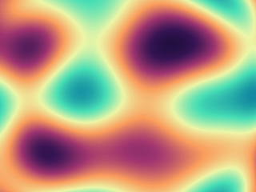
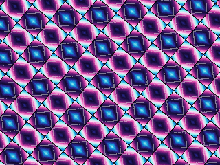

# hdmi_plasma: Tidal glass / Prism weave

Two original hardware light fields race the HDMI beam: a breathing, flowing plasma
and a turning mosaic of luminous cut-glass tiles. Every active pixel is calculated
from its coordinates and a small frame state, one pixel per 25 MHz clock. There is
**no frame buffer, CPU, firmware, downloaded art, or DIP-switch input**. The formulas,
palettes and tile treatment were designed for this demo.




The pictures are independent software renders, sampled to 320 × 240; they are not
captures of the emulator or a board. The live output is 640 × 480. Both effects use
the gallery's [video_life](../video_life/) HDMI path: the same 25 → 125 MHz PLL,
TMDS encoders and four `ODDRX1F` lanes, reused through the same relative symlinks to
[hdmi_moving](../../ulx3s/hdmi_moving/). Pins and pulls in [top.lpf](top.lpf) are
identical to video_life, including GPDI, L4 UART out / M1 in at 115200 8N1,
seven buttons and eight LEDs.

## The integer definition

Let `x=0..639`, `y=0..479`, `u=x−320`, `v=y−240`. `T` is an unsigned 16-bit
animation clock, initially zero. At the end of each picture it advances by
`1 << speed`, modulo 65536, unless paused; default `speed=1` gives two ticks per
frame. The frame number advances even when paused. At the default rate a phase
turn takes 512 frames, about 8.6 seconds, with small, smooth steps each refresh.

`S(p) = floor(255 sin(2π (p mod 1024)/1024) + 1/2)` is a 1024-entry signed
9-bit sine table, representing a Q1.8 coefficient with extrema −255 and +255.
Cosine is `S(p+256)`. All division below means **floor**, including division of
negative values; arithmetic right shifts implement it. Every phase lookup wraps
modulo 1024 and every palette index modulo 256. Intermediate products retain their
full precision before the explicitly specified reductions.

**A — Tidal glass (plasma).** Four waves cross a drifting diagonal and concentric
squared-radius ripples. Their average moves through an animated palette:

```text
a = 3x + 2T
b = 4y − 3T
c = 2(x+y) + T + floor(S(T)/2)
d = floor((u²+v²)/128) − 2T
q = floor((S(a)+S(b)+S(c)+S(d)+1020)/8)
index = (q + floor(T/4)) mod 256
RGB = palette[index]
```

`q` is in 0..255. The asymmetric 3:4:2 spatial rates and the slow frame-dependent
diagonal bend keep the field moving without ever storing an image. Squared radius
is intentional: these are dispersing ripples, not a square-root distance field.

**B — Prism weave (rotozoom).** A breathing rotation carries a faceted, checker-shifted
lattice across the screen. Define `C=S(T+256)`, `D=S(T)`, `Z=192+floor(S(T)/4)`
(128..255). Rotation and zoom each have a separate Q8 reduction:

```text
U = floor((uC−vD)/256)              V = floor((uD+vC)/256)
A = (floor(UZ/256)+floor(T/4)) mod 256
B = (floor(VZ/256)−floor(T/8)) mod 256
f = A mod 64                      g = B mod 64
tri(k) = min(k,63−k)
checker = (floor(A/64) XOR floor(B/64)) AND 1
index = (5tri(f)+3tri(g)+64checker+floor(T/4)) mod 256
diamond = abs(f−32)+abs(g−32)
```

Start with `palette[index]`. If `f<2` or `g<2`, divide each RGB channel by eight
for the dark gutters. Otherwise, if `29≤diamond≤31`, replace each channel `c`
with `112+floor(c/2)` for a luminous diamond seam. Otherwise leave it alone.
The dark-gutter rule has priority. This is an original tile field, not a copied
demo texture or a stored tunnel map.

### Three cyclic palettes

Each row below gives eight original RGB anchors at indices 0, 32, …, 224.
For `index=32k+w`, each channel is
`floor(((32−w) anchor[k] + w anchor[(k+1) mod 8])/32)`. There is no gamma
conversion. Palette phase motion is already included in each effect's `index`.

| P | Name | Eight anchors, RGB hex |
|---|---|---|
| 0 | Estuary | `070A28 182C70 0D829F 47DEB5 EDF6A8 FA9D5D A23670 371454` |
| 1 | Emberfoil | `120C19 531637 BE2F31 F6862C FFE79E 9DC39B 1E757E 232D4E` |
| 2 | Ion orchid | `12092F 2B2995 1199DC 98F7EF FBD7F3 E550B1 6C1B77 281554` |

[make_tables.py](make_tables.py) reproduces [sine.hex](sine.hex) and
[palette.hex](palette.hex) with Python's standard library. The latter has 768
used entries and 256 defined black padding entries. Regenerating the tables is
optional; the checked-in hex files are the hardware's inputs.

## Eight clocks, then the wire

[render.v](render.v) accepts new coordinates every clock. RGB and **all** raster
signals (`de`, both syncs, last-active-pixel and raster-end tags) take exactly eight
register stages. The CRC and TMDS encoder sample the same aligned RGB/de pair.

| Stage | Work within its 40 ns budget |
|---|---|
| 1 | centre coordinates; form the three linear sine phases |
| 2 | two squares and four rotation products |
| 3 | radius sum/phase; rotation sum/difference and Q8 reduction |
| 4 | four synchronous sine ROM reads; two zoom products |
| 5 | sum four signed waves; Q8 zoom reduction and lattice translation |
| 6 | normalize plasma / form tile index and seam flags; palette address |
| 7 | synchronous RGB palette ROM read; delay seam flags |
| 8 | per-channel gutter or seam shading |

Latency is **320 ns**, throughput **one pixel every 40 ns**. Nothing iterates per
pixel, divides by a variable, or waits for a previous pixel. Two additional sine
ROM ports continuously produce the frame's rotation/warp coefficients; they settle
during blanking after a state change. No active pixel sees changing frame constants.
Six signed products in stage 2 and two in stage 4 are intended for eight
`MULT18X18D` DSP blocks. Each operand fits inside 18 bits.

Timing is 800 × 525 total: 640 active, 16 front porch, 96 low HS, 48 back porch;
480 active, 10 front porch, 2 low VS, 33 back porch. At 25 MHz this is
**59.524 frames/s**, 420,000 clocks / 16.8 ms per frame, with 36,000 vertical-blank
clocks. The shift domain is 125 MHz, five shift clocks per pixel; DDR sends ten
TMDS bits per pixel at 250 Mbit/s per data lane. This is the same monitor timing
already used by video_life.

## Controls and deterministic output

| Button | UART key | Action |
|---|---|---|
| FIRE1 | `e` | alternate effects A / B |
| FIRE2 | `p` | pause / resume animation, including palette motion |
| LEFT / RIGHT | `[` / `]` | previous / next palette, wrapping through all three |
| UP / DOWN | `+` / `-` | speed index 0..3: 1, 2, 4 or 8 animation ticks/frame; saturates at the ends |
| — | `r` | exact power-on settings and T=0; next picture is F0000; print `RESTART` |
| PWR | — | unused |

Every button uses two synchronizer flip-flops, then **25,000 stable clocks (1 ms)**
on each edge. Accepted press pulses are latched until the frame boundary consumes
them. Releasing between boundaries does not cancel a press; holding gives one event
until a stable release. This applies the [oled_bricks P18 lesson](../oled_bricks/README.md):
at 0.5 MHz emulation the filter takes 50 ms of wall time, instead of the old
250,000-cycle filter's 500 ms. Still shorter pulses can be filtered out. The window
script holds buttons for two seconds to accommodate slower operation.

UART input waits in a 256-byte FIFO, preserved across restart. One command is
consumed at the start of vertical blank, with UART priority, then FIRE1, FIRE2,
UP, DOWN, LEFT, RIGHT priority for pending buttons. Other pending buttons remain
latched. As in video_life, this is a command interface rather than an unlimited
sustained input stream: keep bursts within 256 pending bytes and let them drain
at one byte per frame. Unrecognized keys are silent.

LED7 means paused, LED6:5 show speed, LED4:3 palette, LED2 effect, and LED1:0
`T[7:6]` as an animation heartbeat. No DIP inputs are declared or sampled.

After each complete picture, [top.v](top.v) prints:

```text
RESTART
F0000 E0 P0 C922DF993
F0001 E0 P0 CE0120AF6
F0002 E0 P0 C0B821D1B
F0003 E0 P0 C5882E826
```

All lines use CRLF. The `F` field is hexadecimal width four, effects/palettes are
zero-based, and `C` is eight hexadecimal digits. CRC-32/ISO-HDLC starts at
FFFFFFFF, folds R then G then B for each active pixel in scan order, bits LSB
first with EDB88320, then complements. It is exactly `zlib.crc32` of the RGB byte
stream used by the emulator's HDMI receiver. The window records
`# monitor frame N 640x480 crc XXXXXXXX`; [gui_run.py](../gui_run.py) recognizes
the frame line and compares CRCs. A restart renumbers the design's frames, not
the receiver's lifetime counter; the check also compares CRC membership.

A changing control prints one `SET E0 P0 S1 H0`-style event **after** the preceding
frame line; it describes the next picture's effect, palette, speed and hold/pause
state. Saturated speed requests and unknown keys print no event. At a boundary,
T first advances with the **old** speed/pause; then the command applies. `r`
instead sets everything to the initial state, finishing the old frame's full report
before `RESTART`. No marker is printed at power-on. The raster continues through
restart, and the first complete new picture is F0000 at T=0, regardless of when
the command arrived.

The 23-byte frame line takes at most 49,979 clocks (2.0 ms), longer than vertical
blank. A dedicated UART sequencer holds the completed frame's CRC and metadata
while transmission continues into the next raster. It deterministically waits for
each byte to finish; it never stalls the pixel pipeline. The longest transaction,
frame plus 17-byte SET, is at most **86,920 clocks (3.48 ms)**, far below the
420,000 clocks before another report. There is no overwritten report or dropped
output. A restart marker is nine bytes and also fits this budget.

## Reproduce the RTL and independent checks

```sh
sh examples/gallery/hdmi_plasma/sim/run.sh
python3 examples/gallery/hdmi_plasma/model.py --effect 1 --palette 2 --frame 72
```

The RTL checks use Verilator and a Yosys `read_verilog; hierarchy -check -top top;
proc` syntax/elaboration check. Compilation uses **`make -j 1`**
and quoted paths that work in this checkout's directory containing spaces.
All generated C++, executables, raw UART transcripts, logs and other debug files
stay under this demo's ignored `target/` directory.

[sim/run.sh](sim/run.sh) runs the real top/render/I/O RTL with only the device PLL
and TMDS output replaced by [sim/stubs.v](sim/stubs.v). The PLL stub makes the pixel
clock the input clock; the output stub independently samples the TMDS **input**,
not emulated pads. [sim/uart_tb.cpp](sim/uart_tb.cpp) checks UART framing, 640 pixels
per line, 800-clock line pitch, 480 active rows, 96-clock HS and 1600-clock VS,
then compares zlib's pixel-stream CRC with every printed C field. Every completed
picture must have a completed report when the run ends.

The configured 25,900,000-clock run covers exactly **60 pictures after RESTART**:
[expected/uart.txt](expected/uart.txt) has 61 CRLF lines and **1,389 bytes**. Its
pre-marker power-on picture is checked too, but excluded from the golden file.
The simulation reruns the same input and demands byte-identical raw UART output.
Subsequent runs also compare against the existing golden and fail on any difference;
they create it only if it is absent. `check.json` sends just `r`, has no `needs`,
and listens on the board for 4 seconds, almost four times the simulated interval.

A second 64,100,000-clock run checks 152 full pictures, 19 control events and two
explicit restart markers. It drives **all six actual control pins** with seven
30,000-clock presses wholly between frame reads, including FIRE2 twice. It also
queues a UART burst, exercises all palettes, clamps speed, pauses across several
frames, covers negative sine/cosine coefficients in both effects, and receives a
restart during a frame report. The already printing line remains complete.

[model.py](model.py) independently evaluates the equations above as whole fields
with Python integers. It reads neither RTL, ROM files nor internal simulation
state. It reconstructs T from the public frame/event protocol, checks event order,
frame numbering and state, and **fails on any CRC mismatch**. Every reported frame
is checked, including repeated paused frames, with at least five negative-S(T)
frames of each effect. PNGs use only Python's `struct` and `zlib`, without PIL.
With a constant speed, `--frame N` means `T = N*(1<<speed) mod 65536`.

**RTL/model result:** all **212 frame CRCs equal — A: 173, B: 39**, covering
162 distinct pictures and 15 setting/quadrant combinations. Both full golden
runs were byte-identical; the control sequence, UART framing, raster checks and
Yosys syntax/elaboration check passed. The latter emits only the expected warning
that button debounce counters are registers.

## Resources and window script

The design uses eight signed products, sine/palette ROMs, a PLL and four ODDRX1F
lanes. The pixel and shift clock requirements are 25 and 125 MHz. The check
records below identify the built configuration and bitstream; they contain no
mapped resource counts or routed Fmax measurements.

[ecp5.toml](ecp5.toml) lists the sources and constraints. [gui.script](gui.script)
runs for 120 s: restart, animate, FIRE1 at 48 s, LEFT at 80 s, then quit.
The Monitor opens automatically from the driven GPDI pads.

## Checks

Emulator, board and window records are in
[HR03](../../../docs/inventory/LFE5U-85F/hr03_gallery/README.md), **2026-11-18**.

**RTL:** PASS: **212 frame CRCs** equal the independent Python model
(A: 173, B: 39), including controls, raster timing and byte-identical golden
reruns; [sim/run.sh](sim/run.sh), [model.py](model.py),
[expected/uart.txt](expected/uart.txt). Yosys syntax/elaboration passed.

**Emulator:** the board's own configuration (`ac678206`),
[hdmi_plasma.config.gz](../../../docs/inventory/LFE5U-85F/hr03_gallery/hdmi_plasma.config.gz),
passed **1 389 bytes from RESTART** on rserv without rebuilding. Fast mode
`d377f3e`: **28 690 000 cycles in 35.332 s, 0.81 MHz**
(earlier: 39.637 s, 0.72 MHz);
[emulator_board_configs.log](../../../docs/inventory/LFE5U-85F/hr03_gallery/emulator_board_configs.log).

**Board:** **3 of 3 SRAM loads PASS** on 1 389 bytes. The Python model recomputes
all **239 complete board frames' CRCs**. `top.bit` SHA-256:
`2b91d6d64b138a9bd781a5c058709f00dc87e9f3c1320cd198559cde6eb5904e`.
Records: [observations.log](../../../docs/inventory/LFE5U-85F/hr03_gallery/observations.log),
[SHA256SUMS](../../../docs/inventory/LFE5U-85F/hr03_gallery/SHA256SUMS),
[hdmi_plasma.board_uart_1.txt.gz](../../../docs/inventory/LFE5U-85F/hr03_gallery/hdmi_plasma.board_uart_1.txt.gz).
The board's video was not captured; the frame check uses UART CRCs.

**Window:** 120 s under `out/screen.lock`, display awake and unlocked at both ends:

- **7 175 window frames**, median 16.7 ms, p95 17.2 ms;
- **78 467 555 cycles** (3.139 s of board time), **0.65 MHz**;
- **13 LED drawings, 0 wrong**; FIRE1 ×1, LEFT ×1;
- console **PASS on 1 389 bytes from RESTART**;
- **185 decoded 640 × 480 HDMI frames painted**: all 185 decoded CRCs occur
  among the design's printed CRCs, and all **182 printed CRCs** were decoded
  from the pads. The receiver numbers from power-on and the design from RESTART,
  so matching is by CRC, not frame number.

Receiver evidence: [hdmi_plasma.window_monitor.txt](../../../docs/inventory/LFE5U-85F/hr03_gallery/hdmi_plasma.window_monitor.txt).
