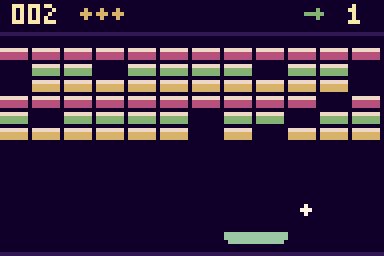

# oled_bricks: Orchard

Orchard is an original brick-breaker on the ULX3S's 96 × 64 SSD1331 colour OLED.
Its plum, sage and clay field, three irregular planting masks and little five-row digit
font were drawn for this demo. There are no downloaded assets, sound effects, CPU,
firmware or frame buffer. Everything runs in one 25 MHz clock domain, without a PLL.

The lesson is that a display can be driven directly from logic: while an SPI shifter
sends one pixel, a circuit computes the next from coordinates and a small game state.
The four DIP inputs also show why an unconnected switch needs its pad pull.



## From state to pixels

[render.v](render.v) is `pixel = f(x, y, state)`. The top strip shows a three-digit
score, one diamond for each life, a pilot chevron (a square in human play), and the
level number. Below are twelve columns of 7 × 3 bricks on an 8 × 4 pitch, a small
diamond ball and a notched paddle. State consists of a 72-bit brick mask, ball and
paddle coordinates, score, lives and level. Pixels are never stored.

The three original masks are a case ROM in [game.v](game.v), with 62, 36 and 42
bricks. `#` is a brick; rows below read from the panel's top left:

```text
    Canopy          Channels        Lanterns
############    .##...####..    #..####..###
.##.####.##.    .##...###..#    #..####..###
.##########.    ##...##.##..    ..###..###..
##########.#    .##...##.##.    ##...##...##
#.####.##.##    ..###..###..    ..###..###..
############    ##...##...##    .####..####.
```

Clearing a mask advances to the next, wrapping after level three. Each hit adds one
point; the decimal score wraps at 999. In human play, a missed ball costs one
life and waits on the paddle for FIRE1 to serve again, keeping score and bricks.
Three missed balls end a normal game. Attract games start again after 100 pictures
(about two seconds). A human game holds its game-over picture until FIRE1 starts another human game, or `r`/FIRE2
restarts attract mode.

## Stream and physics

[top.v](top.v) holds OLED RES# low for at least 25,000 clocks (1 ms), then sends the
37 common init bytes from [oled_pattern](../../ulx3s/oled_pattern/top.v), including
`A0 72`: RAM (0,0) is the upright picture's top left. Each picture explicitly sends
`15 00 5F 75 00 3F`, followed by 12,288 data bytes: 96 × 64 RGB565 pixels, high byte
first. Both address-window commands reset the SSD1331 fill origin.

SPI is mode 0, MSB first, with four clocks per bit: 6.25 MHz within each byte.
Three setup/handshake clocks separate bytes. A data fill budgets 430,080 clocks
(17.2032 ms); the six window bytes take another 210 clocks. A normal picture-to-picture
interval including the 29-byte UART report and physics is **493,387 clocks**, or
**50.67 fps**. Event lines lengthen that interval; no pictures or output bytes are skipped.
The sampled first-to-last SPI rising-edge span is 430,074 clocks inclusive.

CRC-32/ISO-HDLC starts at FFFFFFFF, folds each data byte LSB first with polynomial
EDB88320, then complements the result. Eight fabric clocks do that work while SPI
shifts the same byte MSB first. Commands never enter the CRC. This is zlib's `crc32`
over exactly one complete window fill, before RGB565 colour expansion.

Only between fills, [game.v](game.v) advances signed Q8.4 positions by signed Q4.4
velocities. The normal vertical speed is 18/16 pixels per picture: about 57 pixels/s,
so a screen-height flight is about a second. It reflects against the walls, visits
one brick per clock for 72 clocks, removes the first overlap and reflects on the axis
of entry. A downward crossing of the paddle chooses one of five horizontal velocities
from the impact offset. Updates and event printing finish before another fill starts,
so every frame shows one consistent state.

The normal 16-pixel paddle has centre limits **8..88**; the 24-pixel wide paddle
uses **12..84**. At either extreme its pixels reach column **0** or **95** exactly.
Both ranges share the starting centre's even parity (`48 ± 2k`); two-pixel steps
saturate at each limit. Changing width re-clamps the centre before the next picture,
and the autopilot uses the same limits. Drawing and catches both use the half-open
interval `centre − half_width <= x < centre + half_width`, including fixed-point
fractions. The ball's wall limits remain **1..94**: either wall serve is catchable.

## Attract mode and controls

Power-on and restart begin an autopilot game. A fixed-seed 16-bit LFSR controls its
aim error. The paddle pursues the ball with a two-pixel-per-picture speed limit;
after two accurate returns, its larger error aims inward so a wall clamp cannot
turn the deliberate miss into a catch. Attract mode **ignores all
four switches**, including their UART reporting. The
[HR10 board](../../../docs/inventory/LFE5U-85F/hr10_switches/README.md) reads all four
switches ON, while RTL simulation and the default emulator have them OFF.
The same restart therefore produces the same bytes in all three environments.

| Control | Action |
|---|---|
| FIRE1 in attract or at human game-over | start a fresh human game; print `PLAYER` |
| LEFT / RIGHT | a filtered click gives one two-pixel step; holding repeats every picture |
| FIRE1 while a human ball is waiting | serve it, preserving score, bricks and remaining lives |
| FIRE2 or UART `r` | return to the exact power-on game and OLED init; print `RESTART` |
| UP / DOWN | unused |
| PWR | unused; this button is active low |

| Human-only switch | ON means |
|---|---|
| SW1 / sw[0] | fast vertical speed, 27/16 pixels per picture, applied at a bounce or launch |
| SW2 / sw[1] | wide paddle: 24 rather than 16 pixels |
| SW3 / sw[2] | ink/copper colour theme |
| SW4 / sw[3] | practice: misses cost no lives |

### Controls in the window

Buttons pass through two synchronizer flip-flops. LEFT/RIGHT then require **25,000
stable cycles** on press and release (1 ms at 25 MHz): a short noise filter, with
movement remembered until the next frame update. A click that ends between updates
still earns exactly one step; a held button repeats. Releasing does not cancel a
step already remembered for that frame. FIRE1/FIRE2 require **50,000 stable cycles**
on each edge (2 ms at 25 MHz), retaining a longer debounce and one press event per
stable press/release while avoiding the old 250,000-cycle click threshold.

At **2 MHz**, those filters take about **12.5 ms** for movement and **25 ms** for
FIRE; at **0.5 MHz**, they take **50 ms** and **100 ms**. Shorter pulses can still
be rejected at slower rates. Rendering remains frame-based: a normal frame is
493,387 cycles, about 247 ms at 2 MHz or 987 ms at 0.5 MHz. Accepted input waits
for an update and the following SPI fill to become visible; held speed remains
two pixels per frame (about 8 pixels per wall second at 2 MHz).

After a human `MISS` with lives remaining, the ball rests directly above the paddle
(centre at row 56, bottom row 57, paddle top row 58) and follows its updated centre
without a frame of lag. A hand-drawn 3 × 5 **FIRE1** prompt appears above it. FIRE1
serves the ball and removes the prompt; score, the brick layout and remaining lives
are preserved. An ordinary re-serve prints no new `PLAYER` or `RESTART` line.

Human game-over prints `OVER score` once, keeps LED7 lit and holds the paddle and
ball still, even with a movement button held. Frame reports continue with the
static picture's CRC. FIRE1 prints `PLAYER`, resets score/lives/layout and leaves
the ball waiting with the FIRE1 prompt for another press to launch. Only
`r`/FIRE2 prints `RESTART` and returns to the autopilot.

Switches retain their two synchronizer registers and 250,000-cycle (10 ms at
25 MHz) debounce. Stable switch changes in human play print `SW xxxx`, **sw[0] first**,
and wait in a small event FIFO until the current frame report finishes. Initial settling
and restart are silent. Starting human play samples the current switch settings.
SW1–SW4 use E8, D8, D7, E7, `PULLMODE=DOWN`: ON reads 1; OFF floats and reads the pull.

LED0–LED2 are a three-life bar; LED3 is off; LED4–LED5 show the zero-based level in
binary; LED6 means a ball is waiting; LED7 means human play. UART is 115200 8N1 on
L4 out / M1 in. [io.v](io.v) adapts the gallery UART, 256-byte RX FIFO and button
debouncer from ebr_life. Restart preserves the RX FIFO and finishes the current TX
byte before its marker, discarding the remainder of an interrupted line. Frames
start again at F0000. Game events are queued and printed before the next picture.

## Output and reproducible checks

An excerpt of [expected/uart.txt](expected/uart.txt), with CRLF on every line:

```text
RESTART
F0000 C8B3CC0EE S000 L3 B62
F0001 CF422D12A S000 L3 B62
...
F000E CB8D38568 S000 L3 B62
HIT 06 5
F000F C288FA5F7 S001 L3 B61
...
MISS
```

`HIT` columns and rows are zero-based. Other events are `LEVEL n`, `OVER score`,
`PLAYER`, `SW xxxx`, and `RESTART`. A frame report describes the picture just sent;
subsequent event lines describe the update used for the next picture.

```sh
sh examples/gallery/oled_bricks/sim/run.sh
examples/ulx3s/build.sh examples/gallery/oled_bricks target/gallery/oled_bricks
python3 examples/gallery/check.py oled_bricks --emulator
```

[sim/run.sh](sim/run.sh) works in paths containing spaces. Verilator drives released
buttons (`btn[0]=1`), switches 0000 and UART `r`. Independent C++ pad decoders check
all 37 init bytes, every full address window, SPI timing, 12,288-byte fill lengths,
frame numbers, UART framing, and zlib CRCs. A completed fill without a completed
UART report at the end is a failure. The configured 75,000,000-clock window ends
after F0096's report and before the next fill completes: **151 frame lines, 4 HITs,
1 MISS, 4,434 bytes**. Normal runs compare against the existing expected text and
fail if any byte changes. For intentional physics/layout revisions,
`ORCHARD_REGENERATE=1 sh examples/gallery/oled_bricks/sim/run.sh` regenerates the
UART transcript and the captured frame from simulation.
The checked attract run ends with F0096's `C89DC07BB`.

The script also compares an all-switches-ON attract run byte for byte, restarts during
a UART frame report, and exercises human start, launch, movement and switch changes.
The P18 case drives actual button pins and inspects independently decoded SPI
pictures: a 30,000-cycle LEFT pulse wholly between updates gives exactly one step,
held RIGHT moves every frame, and 120 human game-over pictures stay identical with
RIGHT held. FIRE1 must then produce a fresh human game and a second `PLAYER` line.
All three lost lives are played through without forcing internal RTL state.
The P27 pin/SPI case holds LEFT and RIGHT to both wall-touching extremes at each
width, and changes SW2 at both ends with movement released to check re-clamping.
A separate [game unit test](sim/game_tb.cpp) serves every ball column 1..94 at both
widths, including exact wall serves and fractional catch boundaries, and checks
saturating steps from odd centres. Its state injection lives only in
[sim/game_tb.v](sim/game_tb.v), guarded by `ORCHARD_GAME_TEST`; synthesised RTL
and the project source list contain no test hooks.
The P28 pin/SPI/UART case plays through real life losses, moves the waiting ball
with the paddle and serves with FIRE1 while checking score, complete brick pixels
and lives. It verifies the FIRE1 prompt's pixels while waiting, its absence after
launch, and a fresh full-life layout after game-over and FIRE1. The serve path
preserves the game state while checking the cue and waiting ball position.
Eight Python regression tests cover the gallery's required peripheral models, rejected
OLED status/CRCs, startup pictures without completed frames, the last-painted-picture
exception, the OLED evidence file and existing HDMI CRC summaries.

Frame F004B is saved from the decoded SPI bytes and enlarged ×4 into [frame.png](frame.png).
[sim/png.py](sim/png.py) uses only Python `struct` and `zlib`; RGB565 channels expand by
repeating their high bits, exactly as the OLED model does. Raw pictures, timing CSVs,
transcripts, compiled simulation and all other debug output default to
`target/gallery/oled_bricks/sim/`. Set `ORCHARD_SIM_OUT` to use a different output
folder. Compilation uses `make -j 1` with [sim/Makefile](sim/Makefile), whose quoted
compiler recipe also works in paths containing spaces.

`check.json` selects only `oled` as its required peripheral; older demos continue to
require `sdram` by default. Its zero margin keeps the peripheral's last completed CRC
inside the printed-CRC set. Board listening time is 3 seconds of simulation plus 3 seconds.

## Resources and window script

Recorded Mac build of 769ebb4, before the P18/P27/P28 controls revisions: Yosys /
nextpnr-ecp5 for LFE5U-85F CABGA381, seed 1:

- 3,227 total LUTs (3.9%): 1,801 logic, 1,228 carry, 132 RAM and 66 RAMW;
- 651 TRELLIS_FF and 3,693 packed TRELLIS_COMB (4.4%);
- 33 TRELLIS_RAMW for the RX and switch FIFOs, 27 IO and one DCCA;
- 2 inferred MULT18X18D in the renderer's index arithmetic;
- no DP16KD, ALU54B, PLL or IOLOGIC;
- routed **Fmax 50.31 MHz**, passing the 25 MHz requirement.

These resource/timing figures describe the original build only; current P27/P28
configuration, board and window results are recorded below.

[ecp5.toml](ecp5.toml) lists every synthesised source and [top.lpf](top.lpf).
[gui.script](gui.script) runs for 90 wall seconds: restart, twenty seconds of attract,
human start and launch, one-second LEFT/RIGHT holds, SW2 then SW1 ON, and more play.
The OLED view opens automatically from the driven pins. `gui_run.py` reports painted
pictures and their frame-count range, matches their data CRCs to the design's UART,
and lists `SW` and `PLAYER` events. Pictures before the first completed frame have a
placeholder CRC and are counted separately. Of pictures with completed frames, only
the final painted picture may precede its UART line. Each completed-frame picture is
written to `target/gallery/oled_bricks/gui_oled.txt` as serial, frame count, data CRC
and `printed`/`unprinted`.

## Checks

These checks are of the **P27/P28 build**, commit **“the paddle reaches both
walls; a visible serve prompt”**, on **2026-11-18**. P18 remembers short movement
clicks, repeats holds and keeps human game-over still until FIRE1 starts a new
game; P27 makes both paddle widths reach both walls; P28 adds the FIRE1 serve
prompt and makes the waiting ball follow the paddle without a frame of lag.

**RTL:** PASS: SPI/UART timing and CRCs, **151 frames, 4 HITs, 1 MISS,
4 434 bytes**, identical all-switches-ON attract output, restart and P18/P27/P28
pin/SPI/control checks, plus paddle catch boundaries;
[sim/run.sh](sim/run.sh), [expected/uart.txt](expected/uart.txt).

**Emulator:** the board's own configuration (`630b5018`),
[oled_bricks_p28.config.gz](../../../docs/inventory/LFE5U-85F/hr03_gallery/oled_bricks_p28.config.gz),
passed **4 434 bytes from RESTART** on rserv without rebuilding. Fast mode
`d377f3e`: **75 000 000 cycles in 68.023 s, 1.10 MHz**
(earlier on this build: 88.536 s, 0.85 MHz). OLED: 151 frames, zero errors,
last completed CRC `89DC07BB` printed by the design;
[emulator_board_configs.log](../../../docs/inventory/LFE5U-85F/hr03_gallery/emulator_board_configs.log).

**Board:** **3 of 3 SRAM loads PASS** on 4 434 bytes; transcripts identical over
**8 888 bytes from RESTART**. `top.bit` SHA-256:
`d402a6128bb5fb840c0ea9ea9e1f82256d319022efbc32c29fea4b2b48c988ef`.
Records: [observations.log](../../../docs/inventory/LFE5U-85F/hr03_gallery/observations.log),
[SHA256SUMS](../../../docs/inventory/LFE5U-85F/hr03_gallery/SHA256SUMS),
[oled_bricks_p28.board_uart_1.txt.gz](../../../docs/inventory/LFE5U-85F/hr03_gallery/oled_bricks_p28.board_uart_1.txt.gz).
This checks UART output; the physical panel was not observed.

**Window:** 90 s under `out/screen.lock`, display awake and unlocked at both ends:

- **5 389 window frames**, median 16.7 ms, p95 17.3 ms;
- **193 943 236 cycles** (7.758 s of board time), **2.16 MHz**;
- **413 LED drawings, 0 wrong**; FIRE1 ×5, LEFT ×4, RIGHT ×4;
- console matched **2 581 bytes** until scripted FIRE1 printed `PLAYER` before
  F0058; control lines: `PLAYER`, `SW 0100`, `SW 1100`, `PLAYER`.
  The second `PLAYER` is FIRE1 starting a fresh game after game-over (P28);
- **398 OLED pictures**: 6 before the first completed frame; **392 of 392**
  others with printed data CRCs.

Picture evidence: [oled_bricks_p28.window_oled.txt](../../../docs/inventory/LFE5U-85F/hr03_gallery/oled_bricks_p28.window_oled.txt).
Earlier build records are retained as provenance in [HR03](../../../docs/inventory/LFE5U-85F/hr03_gallery/README.md).
