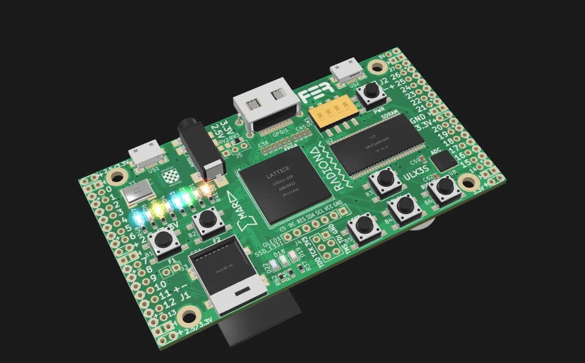

# Getting started

Run commands from the repository root for a source checkout. Start with a release package,
or follow the [full source install guide](../../docs/TOOLCHAIN.md).
The [window guide](window-guide.md) covers the interface; [projects](projects.md) covers HDL inputs.

## Packages and release status

[v0.1.0 is published](https://github.com/r-a-y-z-e-r/ecp5_emu/releases/tag/v0.1.0). Download the archive for your platform:

- **macOS Apple Silicon (arm64), macOS 15+:** `ecp5_emu-0.1.0-macos-arm64.zip`.
- **Linux x86-64, glibc 2.39+:** `ecp5_emu-0.1.0-linux-x86_64.tar.gz` (built on Ubuntu 24.04).

Download `SHA256SUMS` too. In the download folder, run `shasum -a 256 -c SHA256SUMS` on macOS
or `sha256sum -c SHA256SUMS` on Linux. These commands report missing files for archives you
did not download; check that your archive reports `OK`.

Unzip by double-click in Finder or with `ditto -x -k <zip> <dir>`.
On the first open macOS refuses the ad hoc signed app; then use System Settings → Privacy & Security → Open Anyway.
Or, only for a download whose checksum matches `SHA256SUMS`, run `xattr -dr com.apple.quarantine "ECP5 Emu.app"`.

New releases are prepared as drafts by the [release workflow](../../.github/workflows/release.yml)
and published after checks; the
[packaging notes](../../packaging/README.md) record package contents and checks.

The toolchain is bundled: Yosys, nextpnr-ecp5, Project Trellis's ecppack/ecpbram,
GHDL and slang plugins, openFPGALoader and a C compiler (Zig). The database, native image reader,
prebuilt tour, examples and 3D board model are included too. No runtime tool downloads are needed.
See the [bundle manifest](../../packaging/toolchain/components.json),
[launchers](../../packaging/toolchain/stage.py) and [package instructions](../../packaging/README.md).

On macOS, unzip and open `ECP5 Emu.app`; the CLI is
`ECP5 Emu.app/Contents/Resources/bin/ecp5_emu`. On Linux, unpack and run `bin/ecp5_gui` or
`bin/ecp5_emu`. Keep the package's directory structure intact. Packages supply the tool paths;
a source checkout uses `target/release/` after building.

macOS needs a working Metal device. Linux needs X11/Wayland and compatible
Vulkan/OpenGL drivers, plus host runtime libraries (glibc 2.39+ for v0.1.0).
Check the particular archive's requirements in the [package record](../../packaging/README.md#release-builds).

## Requirements

- The [install guide](../../docs/TOOLCHAIN.md) gives the steps for macOS and Linux at the pinned versions.
- Rust 1.92.0, pinned in `rust-toolchain.toml` (rustup installs it on the first build).
- The [Trellis database](https://github.com/YosysHQ/prjtrellis-db) at commit `9754ff47`. The loader
  verifies the database files against the SHA-256 hashes in
  `docs/inventory/LFE5U-85F/model_manifest.json`. Point to the database with `ECP5_DB` or `--db`.
  Without `--db` or `ECP5_DB`, the loader checks `~/FPGA/prjtrellis/database`, then
  `share/trellis/database` and `share/trellis` under `/usr/local` followed by `/opt/homebrew`; an
  installed database at the pinned commit passes the same hash check and may need no separate
  download.
- To open any design in the window (the tour, the start screen's demos, a project's Emulate or
  `ecp5_emu run`), and to `load`/`emulate` `.bit`/`.config` files: the native image reader
  `trellis_image_reader`, built against libtrellis. The install guide builds it with
  `bash packaging/build_trellis.sh` then `bash packaging/build_test_fixtures.sh`. For an existing
  prjtrellis source checkout and libtrellis install, use
  `python3 tools/build_image_reader.py --trellis PRJTRELLIS_CHECKOUT --prefix LIBTRELLIS_PREFIX`.
  It is written to `target/trellis_image_reader`; another location can be given with
  `--image-reader` or `ECP5_IMAGE_READER`.
  Before the tour or any design opens, the window checks for the reader. If it is missing, it runs
  `python3 tools/build_image_reader.py` with `--output` set to that path. The helper discovers a
  prjtrellis checkout and libtrellis, using `TRELLIS_ROOT` / `TRELLIS_PREFIX` or searching standard
  locations. The bare command also works by hand when discovery succeeds; `--trellis` / `--prefix`
  override discovery. If discovery fails, the window shows the script's message naming
  `--trellis`/`TRELLIS_ROOT` and `--prefix`/`TRELLIS_PREFIX`.
- To build designs and to run the native integration tests: Yosys, nextpnr-ecp5 and ecppack.
  Loading a ULX3S with `ecp5_emu load` also needs openFPGALoader on `PATH`.
- For `emulate --fast` and the window: clang on `PATH`, or `ECP5_CLANG` set to an executable path or a command name on `PATH` (use a [wrapper for `zig cc`](../../docs/FAST_MODE.md#use)).
- For the 3D board in the window: the model ships through git LFS (`git lfs pull` if a clone
  has pointer files) and is included in packages. To rebuild it with
  [tools/ulx3s_3d](../../tools/ulx3s_3d/README.md), use KiCad 10's `kicad-cli`, Blender 5.1,
  `rsvg-convert`, Pillow and numpy. A local rebuild in `out/ulx3s_3d/` takes priority over
  the shipped model; `ECP5_BOARD_MODEL` overrides both.

## Quick start

A checkout first needs the toolchain, database and image reader from the
[install guide](../../docs/TOOLCHAIN.md); the window builds a missing reader when it finds a prjtrellis
checkout and libtrellis. Release packages include the database, reader and prebuilt tour.

"Take the tour" on the start screen, or in the project window with no project open, guides you
through `blinky_cycle`: build, Chip, running, source probing, Show in source and Waves. It waits
for the actions it describes; use Next and Show me to move through it.
The [43-second recorded walkthrough](../media/window-tour.mp4) shows a scripted `blinky_cycle`
project sequence with Chip, source probing, constraints and Waves; it does not record the
interactive tour controls.

The first build needs network access for missing crates (`Cargo.lock` lists 435 registry crates) and
the pinned Rust 1.92.0 toolchain if rustup has not installed it; a clean release build of both
binaries took 54 s on an Apple M3 Max (10 performance and 4 efficiency cores) with the crates
already downloaded.

```sh
cargo build --release --locked -p ecp5_emu -p ecp5_gui
target/release/ecp5_gui --tour        # a guided minute on blinky_cycle
```

The tour can use prebuilt `top.config` and `top_routed.json` in `target/reference/blinky_cycle`,
with a captioned build skip if yosys/nextpnr is missing.

A folder with `*.v` files and one `.lpf` is already a project. Every bundled design in
[examples/ulx3s](../../examples/ulx3s/README.md) and [examples/gallery](../../examples/gallery/README.md)
has an explicit `ecp5.toml` and opens directly. The CLI runs Yosys, nextpnr and ecppack on it
(skipping the steps whose inputs did not change), then opens it in the window or loads it into the
board's SRAM:

```sh
target/release/ecp5_emu build examples/ulx3s/uart_hello   # bitstream, utilisation, timing
target/release/ecp5_emu run   examples/ulx3s/uart_hello   # build, then run it in the project window
target/release/ecp5_emu load  examples/ulx3s/uart_hello   # build, then load a ULX3S (SRAM, never flash)
```

An ordered `sources.hdl` list supports Verilog and SystemVerilog, or VHDL-2008 in a VHDL-only
project. SystemVerilog defaults to Yosys's built-in subset; an explicit `slang` pin and VHDL need
OSS CAD Suite ([languages and examples](projects.md#languages)).

The project format (`ecp5.toml`), creating projects with `ecp5_emu new`, the options and the project
window are described on the [projects page](projects.md). Run the install guide's
`blinky_cycle` bitstream from the command line:

```sh
target/release/ecp5_emu device                    # load the full 85F architecture
target/release/ecp5_emu emulate target/reference/blinky_cycle/top.bit \
  --startup configured --scope observed \
  --clock pin:G2 --cycles 16 --probe pin:B2 --vcd run.vcd
```

G2 is the clock and B2 is `led[0]`, which toggles each cycle; the command writes `run.vcd`.
Substitute your bitstream path and your design's clock and output pins to run another design.

Ready-made ULX3S designs are in [examples/ulx3s](../../examples/ulx3s/README.md), with the commands to
build and emulate them: blinky via PLL, UART, a debounced button, block RAM, DSP multipliers, HDMI
and OLED output, audio tones, Conway's Life up to the full chip, SDRAM, SPI flash, ADC, RTC and SD
card access, and the PicoRV32 console. The [gallery](../../examples/gallery/README.md) has fifteen larger
demos, each checked on the board and in the emulator using the same configuration (HR03): a RISC-V
computer with a shell ([riscv_shell](../../examples/gallery/riscv_shell/README.md)), the same computer
with an 80 × 30 text screen on HDMI ([riscv_terminal](../../examples/gallery/riscv_terminal/README.md)),
the same shell on SERV, a bit-serial RV32I core, using a third of the logic and about 16 times the
cycles for `primes 2000` ([serv_shell](../../examples/gallery/serv_shell/README.md)), a burst SDRAM
controller writing and checking all 32 MiB at 44.5 MiB/s writing and 44.8 MiB/s reading, 93–94 % of
the 16-bit bus's rate at 25 MHz ([sdram_bench](../../examples/gallery/sdram_bench/README.md)), Life in
block RAM ([ebr_life](../../examples/gallery/ebr_life/README.md)), tennis on the LEDs
([led_tennis](../../examples/gallery/led_tennis/README.md)), one FIR filter built twice in the DSP blocks
and compared sample by sample on the chip ([fir_scope](../../examples/gallery/fir_scope/README.md)), a
Mandelbrot explorer on the DSP multipliers ([mandelbrot](../../examples/gallery/mandelbrot/README.md)), a
brick-breaker on the OLED computing pixels while SPI sends them, with no frame buffer
([oled_bricks](../../examples/gallery/oled_bricks/README.md)), data across four clock domains through a
dual-clock FIFO, a word handshake and an acknowledged pulse toggle
([clock_domains](../../examples/gallery/clock_domains/README.md)), ten parallel iterative SHA-256 chains
with standard known-answer tests and a digest of all final values, with UART reporting reducing
throughput ([sha256_chains](../../examples/gallery/sha256_chains/README.md)), two original HDMI effects, plasma and rotozoom, calculated one pixel every 40 ns
with no frame buffer ([hdmi_plasma](../../examples/gallery/hdmi_plasma/README.md)), an original four-bar RTL
synthesizer with 25 kHz samples and a 96 × 64 SSD1331 OLED mix scope, with modelled voltages
and no audio playback in the emulator ([chip_synth](../../examples/gallery/chip_synth/README.md)),
PicoRV32 drawing an original faceted lantern in C on a 96 × 64 SSD1331 OLED with two 12 KB EBR
frame buffers ([riscv_oled](../../examples/gallery/riscv_oled/README.md)), and Life on an HDMI monitor,
which the window decodes from the pads and shows
([video_life](../../examples/gallery/video_life/README.md)). The `clock_domains` crossings run with ideal
sampling in the emulator, without metastability, setup/hold windows or routing skew between bus
bits.

```sh
examples/ulx3s/build.sh examples/ulx3s/uart_hello target/reference/uart_hello
target/release/ecp5_emu emulate target/reference/uart_hello/top.config \
  --names target/reference/uart_hello/top_routed.json \
  --startup configured --scope observed --clock net:clk_25mhz --cycles 3 \
  --probe net:ftdi_rxd --probe net:led
```

To run at the board's speed, add `--fast`. Give the real clock period with `--period-ns 40` (25
MHz); a second of the board is `--cycles 25000000`. Fast mode prints the values at the start and the
end, and `--vcd` gets every clock edge ([FAST_MODE.md](../../docs/FAST_MODE.md)).
`--console-out`/`--console-in` put a UART terminal on the design, so you can type to its firmware.
A rebuilt firmware is swapped in with ecpbram in about a second, without place and route
([examples/ulx3s](../../examples/ulx3s/README.md#a-soft-cpu)).

To probe signals by their HDL names, add nextpnr's routed design (`nextpnr-ecp5 … --write
top_routed.json`) with `--names top_routed.json`, then use `net:count`, `net:led` or `net:count[3]`
wherever a pin or wire is accepted ([HDL_NAMES.md](../../docs/HDL_NAMES.md)).

`--startup` is required:

- `configured` is the closest to a real board. The chip starts in user mode right after
  configuration, and every executed flip-flop holds its init value (`REGSET`), with or without
  `SLICE.GSR`. This was observed and repeated on a ULX3S; see
  [hs01_init_slice](../../docs/inventory/LFE5U-85F/hs01_init_slice/README.md). A plain
  `reg [7:0] count = 0;` blinky counts from 0.
- `ready-unknown` starts in user mode with flip-flops at `x` until a reset or a capture defines
  them. It is the conservative profile.
- `wake-phases` steps through the logical wake-up phases on the virtual `sys:step` input.

### Known limitations

- On the board, an input can still read its configuration-time level for a short while after
  wake-up. With a free-running clock, this showed up as extra enabled clock edges (HS01). The
  emulator applies your stimulus from time 0 and does not model this settling.
- Differential pairs are digital only: inputs read P, not N; electrical and invalid-pair behaviour
  are not modelled. True differential standards such as LVDS have not been checked on the board:
  native LVDS output needs a 2.5 V bank, while ULX3S side banks run at 3.3 V. Differential
  bidirectional and open-drain output pairs are refused.
- Fast mode refuses what it cannot run exactly: combinational loops; a pad driven from outside
  unless it is a tristate pad with one outside driver (and it stops if that driver and the design
  drive different levels, where the kernel gives X); a few DSP configurations; a block RAM read that
  the event kernel makes unknown (a collision outside the profiles measured on the board, a control
  combination the board has not shown, or a read of unknown memory). The event kernel still runs
  those ([FAST_MODE.md](../../docs/FAST_MODE.md#what-it-covers)).
- Timing is digital: signals settle in zero-delay delta waves at each moment of virtual time,
  with no wire or gate delays, and physical hazards are not reproduced
  ([EVENT_KERNEL.md](../../docs/EVENT_KERNEL.md)). Designs that rely on analog effects or on
  setup/hold violations are out of scope.

### Toolchain pitfalls

These come from the tools, not the emulator. The emulator runs the
configuration as the tools wrote it, so it shows them as the board does.

- nextpnr-ecp5 gives each DSP block one net per CE and RST line, shared by the block's ALU54B and
  its two MULT18X18D. When the cells were given different nets on one line, it keeps one and drops
  the others without a warning (board runs HD01 and HD04,
  [HARDWARE_VALIDATION.md](../../docs/HARDWARE_VALIDATION.md#results)).
  A hand-instantiated ALU54B whose RST0 differed from its multipliers' constant RST0 never
  cleared. Give every cell of a block the same controls
  ([repro](../../examples/gallery/fir_scope/repro/README.md)).
- Yosys 0.70 stops with "Module … is not part of the design" when a user module declares `signed`
  ports: it elaborates that module again after `flatten` has removed its siblings. Declare the sign
  on wires inside the module instead
  ([repro](../../examples/gallery/fir_scope/repro/yosys_signed_ports/README.md)).

## Database and reader discovery

To select another checkout, point `ECP5_DB` at it and replace the placeholder path:

```sh
export ECP5_DB=/path/to/prjtrellis-db
cargo build --release --locked
bash packaging/build_trellis.sh
bash packaging/build_test_fixtures.sh
cargo run --release --locked -- device
```

`device` loads the architecture. The scripts build the pinned libtrellis, the image reader and the
two reference designs used by the install guide. Before the tour or any design opens, the window
checks for `target/trellis_image_reader` (or `ECP5_IMAGE_READER`). If it is missing, the window runs
`python3 tools/build_image_reader.py` with `--output` set to that path. The helper looks for a
prjtrellis checkout using `TRELLIS_ROOT`, the parent of `ECP5_DB`, `~/FPGA/prjtrellis` and other
standard locations; for libtrellis it uses `TRELLIS_PREFIX` or searches locations including the
Homebrew prefix and `/usr/local`. If discovery fails, the window shows the script's message naming
`--trellis`/`TRELLIS_ROOT` and `--prefix`/`TRELLIS_PREFIX`.

The bare `python3 tools/build_image_reader.py` also works by hand when discovery finds the checkout
and library. To override discovery for an existing installation, use
`python3 tools/build_image_reader.py --trellis PRJTRELLIS_CHECKOUT --prefix LIBTRELLIS_PREFIX`. The
helper compiles [tools/trellis_image_reader.cpp](../../tools/trellis_image_reader.cpp) with the
checkout's headers and the installed library. Release bundles carry a built reader and the database
files. An alternate built reader can be selected with `ECP5_IMAGE_READER` or `--image-reader`.
Database discovery and reader selection are implemented in [database.rs](../../src/database.rs) and
[image.rs](../../src/image.rs).

## Run an existing bitstream

Replace `DESIGN.bit` with your design, and select its actual clock and output pins. This variant of the [quick start](#quick-start) uses Cargo to launch the emulator and writes a VCD file:

```sh
cargo run --release --locked -- emulate DESIGN.bit \
  --startup configured --scope observed \
  --clock pin:G2 --cycles 16 --probe pin:B2 --vcd run.vcd
```

`--startup` is required. `configured` initializes executed fabric flip-flops to REGSET as observed in [HS01](../../docs/inventory/LFE5U-85F/hs01_init_slice/README.md). `ready-unknown` leaves them unknown until reset or capture; `wake-phases` exposes logical startup phases. These profiles do not simulate programming transport. `observed` follows dependencies of the probes; the default `all-plc` adds broader state roots. See [startup and scope in the planner](../../src/compile/mod.rs) and [global controls](../../docs/SYSTEM_EXECUTION.md).

## Build and inspect a reference design

The [example build script](../../examples/ulx3s/build.sh) produces a bitstream, text configuration and routed JSON:

```sh
examples/ulx3s/build.sh examples/ulx3s/uart_hello target/reference/uart_hello
cargo run --release --locked -- emulate target/reference/uart_hello/top.bit \
  --names target/reference/uart_hello/top_routed.json \
  --startup configured --scope observed --clock net:clk_25mhz \
  --period-ns 40 --cycles 16 --probe net:ftdi_rxd --probe net:led --vcd uart.vcd
```

The board clock's **40 ns / 25 MHz** comes from [board.rs](../../src/board.rs). Without `--period-ns`, the CLI uses **2 ns**, as specified by [main.rs](../../src/main.rs). `--names` adds the [HDL overlay](../../docs/HDL_NAMES.md); a bus probe expands to its bits. A name identifies an observation, not a replacement execution model. See [names.rs](../../src/names.rs).

For a longer run, compile the same plan to C:

```sh
cargo run --release --locked -- emulate target/reference/uart_hello/top.bit \
  --names target/reference/uart_hello/top_routed.json --fast \
  --startup configured --scope observed --clock net:clk_25mhz \
  --period-ns 40 --cycles 25000000 --probe net:ftdi_rxd --vcd uart-fast.vcd
```

The cycle count represents a second at the [board clock](../../src/board.rs), not a wall-time guarantee. Fast mode prints endpoint samples; VCD retains edge samples. It may begin with an event-kernel warm start and can refuse unknown values or unsupported plans. Its JSON `--output` trace is unavailable. See [fast-mode use and limits](../../docs/FAST_MODE.md#use) and the [CLI adapter](../../src/command_emulate.rs).

## Open the GUI

The GUI is a separate workspace member in [gui/Cargo.toml](../../gui/Cargo.toml). Its parser accepts the design path, `--names` and `--run`:

```sh
cargo run --release --locked -p ecp5_gui -- target/reference/uart_hello/top.config \
  --names target/reference/uart_hello/top_routed.json --run
```

The [GUI entry point](../../gui/src/main.rs) opens the live view; [live.rs](../../src/live.rs) supplies the board inputs and configured startup. The rendered board model ships through git LFS and in packages; run `git lfs pull` if a clone has pointer files. Select another glTF asset with `ECP5_BOARD_MODEL`, or rebuild it using the [board-model instructions](../../tools/ulx3s_3d/README.md#build). Without that asset the UI provides plain LED and button controls, as described in those instructions.



This image is a saved appearance check, not a live run. Its provenance and remaining geometric differences are in the [board QA record](../../docs/qa/ulx3s_3d/README.md#in-the-gui).

For the interactive UART and firmware replacement workflow, continue with [A soft CPU](../../examples/ulx3s/README.md#a-soft-cpu). For test commands and their prerequisites, use [How it is verified](verification.md).
