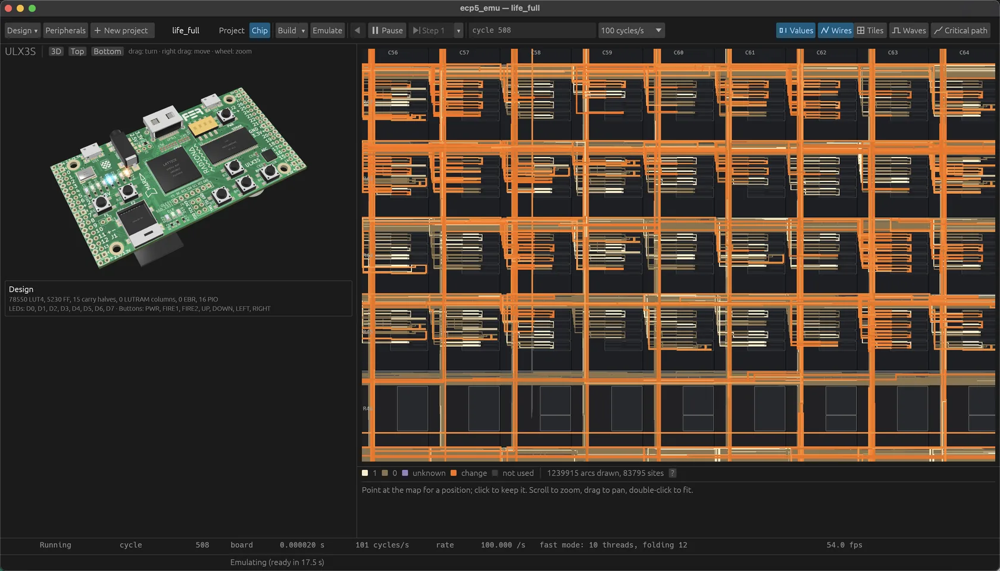

# ecp5_emu

An emulator of the Lattice ECP5 **LFE5U-85F** FPGA that runs the real bitstream from the open
toolchain (Yosys → nextpnr-ecp5 → ecppack), with a live view of the die.

*[`life_full`](../../examples/ulx3s/README.md) at 100 cycles per second around tile
R44C60: live wire values and changes in orange, with the 3D ULX3S beside the map.
Click for a 30-second clip that also fits the whole die and switches to the fastest rate.*

You give it the same `top.bit` you would load into a ULX3S board. It decodes the configuration with
the Project Trellis database and executes it on a structural model of the whole chip: every tile,
site, wire and programmable connection keeps its identity, and so the window can show what
synthesis and place-and-route actually built, running, under the design's own signal names.

The project aims at an open-source educational tool for FPGA students, roughly "Quartus with a
built-in emulator" for the ECP5 and the ULX3S ([ROADMAP.md](../../ROADMAP.md)).

**Documentation:** the [site](../README.md) (built from [docs/](../../docs)) has an
[architecture overview](architecture.md) and a page on
[how the emulator is verified](verification.md).

The [image loader](../../src/image.rs) and [execution planner](../../src/compile/mod.rs) implement this path.

The architecture exists independently of the design. Configuration, mutable state and execution are separate layers. An event kernel provides four-valued logic and explainable transitions; a compiled executor serves longer runs. HDL names are an optional overlay from nextpnr's routed JSON. These choices make it possible to inspect a configured design without replacing its bitstream with an RTL simulation. [Architecture](architecture.md) explains the implementation and its boundaries, with links to the [model](../../src/model/mod.rs), [kernel](../../src/kernel/mod.rs), [fast executor](../../src/fast.rs) and [name overlay](../../src/names.rs).

This is a partial digital model. Supported profiles are checked in software and, for recorded cases, against a physical ULX3S. Unknowns, explicit refusals and named assumptions remain part of the interface; passing a reference design does not establish the whole device's behaviour. Start with [How it is verified](verification.md), the [hardware results](../../docs/HARDWARE_VALIDATION.md#results) and the [settings coverage](../../docs/SETTINGS_COVERAGE.md).

The code is licensed under the [Apache License, Version 2.0](../../LICENSE); third-party material
keeps its own licences ([licenses/README.md](../../licenses/README.md)), and release packages carry
`LICENSE` and `THIRD_PARTY_NOTICES.txt`.

- [What it does in detail](overview.md): supported modes, peripherals and measured numbers.
- [The window](window-guide.md): projects, chip map, Waves and source cross-probing.
- [Tests](tests.md): prerequisites, per-area commands and measured times.
- [Getting started](getting-started.md): build the emulator, run a bitstream, open the GUI.
- [Architecture overview](architecture.md): the pipeline, state, executors and live views.
- [How it is verified](verification.md): checks, evidence and open questions.
- [Using it](../../examples/ulx3s/README.md): example designs and the soft CPU workflow.
- The sidebar's execution, resource and research chapters preserve the original technical records. Many describe an earlier milestone; use their dates and continuation notes when reading them.
- [Roadmap](../../ROADMAP.md): goals and work order; [original plan](../../PLAN.md): historical design context.
