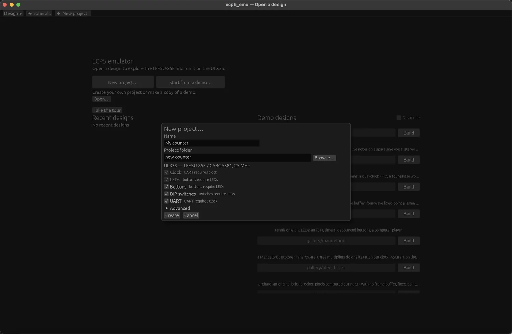
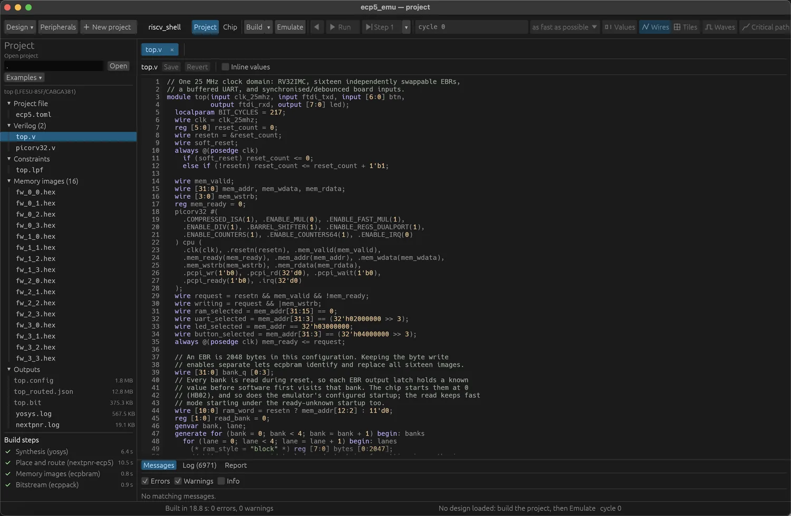

# Projects: from HDL to the emulator and the board

A project is a folder of HDL and constraints. One command builds it with the open toolchain,
then opens it in the emulator's window or loads it into a ULX3S. The window builds and emulates in a
Quartus-like layout: sources, an editor, the build's steps, messages, log and report, then the
chip running. Board loading uses `ecp5_emu load PROJECT`. The code is in
[src/flow/](../../src/flow), the command line in
[src/command_flow.rs](../../src/command_flow.rs) and the window in
[gui/src/project.rs](../../gui/src/project.rs).

## A project folder

A folder with `*.v` files and exactly one `*.lpf` is already a project. Every design in
[examples/ulx3s](../../examples/ulx3s/README.md) and [examples/gallery](../../examples/gallery/README.md)
has an explicit `ecp5.toml` and opens directly. Without an `ecp5.toml` the defaults are:

- top module `top`;
- the Verilog files read in sorted order, as `ls *.v` lists them;
- `*.hex`, `*.mem`, `*.vh`, `*.svh` and `*.init` files copied next to the sources, so
  `$readmemh` and `` `include `` find them;
- images to swap after place and route listed explicitly in `ecpbram.txt`, if there is one;
  other files read with `$readmemh` are built in by Yosys.

An `ecp5.toml` in the folder overrides any of these. Every key is optional; an unknown key is an
error, and so is a path that is absolute or contains `..`. Paths are relative to the project
folder and may name subfolders; symlinked sources work (the gallery's computers share one
`picorv32.v`). The format, from [src/flow/project.rs](../../src/flow/project.rs):

```toml
[project]
name = "blinky_cycle"    # default: the folder's name
top = "top"              # default: top
[sources]
verilog = ["top.v"]      # default: sorted *.v in the folder
constraints = "top.lpf"  # default: the single *.lpf
files = ["message.hex"]  # default: *.hex *.mem *.vh *.svh *.init, minus memory images
# hdl = ["a.v", "b.sv"]  # opt-in ordered roots; remove verilog to use this
# include_dirs = ["."]   # default with hdl; invalid without hdl
[synthesis]
sv_frontend = "auto"     # default: auto; auto | builtin | slang
[memory]
images = ["fw0.hex"]     # default: the non-comment lines of ecpbram.txt, else none
[device]
part = "LFE5U-85F"       # default: LFE5U-85F
package = "CABGA381"     # default: CABGA381
speed = 6                # omitted by default; passed to nextpnr only if given
[build]
dir = "build"            # default: build; cannot be the project folder
seed = 1                 # default: 1
allow_timing_failure = false  # default: false
```

The PicoRV32 console, for example, names its sources and its four firmware images, one byte lane
per block RAM ([ecp5.toml](../../examples/ulx3s/picorv32_console/ecp5.toml)):

```toml
[project]
name = "picorv32_console"
top = "top"

[sources]
verilog = ["picorv32.v", "top.v"]
constraints = "top.lpf"
files = []

[memory]
images = ["fw0.hex", "fw1.hex", "fw2.hex", "fw3.hex"]
```

### Languages

`[sources] hdl = ["a.v", "b.sv"]` opts into an ordered list of compilation roots. The suffix
selects the language: `.v` is Verilog, `.sv` is SystemVerilog, and `.vhd` or `.vhdl` is VHDL.
`hdl` cannot be combined with `verilog`. `include_dirs` defaults to `["."]` and is valid only
with `hdl`; list included headers in `sources.files`, since directories do not copy their contents.

`[synthesis] sv_frontend = "auto"` (the default) and `"builtin"` use Yosys's built-in reader,
with `read_verilog -sv` for SystemVerilog. The measured subset is listed in
[blinky_sv](../../examples/ulx3s/blinky_sv/README.md). `"slang"` is an explicit pin: auto never
selects it, and a failed slang build is never retried with the built-in reader.

Slang and VHDL require OSS CAD Suite: set `ECP5_OSS_CAD_SUITE` to the suite root, or run
`source <suite>/environment` so the suite's `yosys` is on `PATH`. Packages set the suite variable.
VHDL uses the GHDL plugin with VHDL-2008; VHDL projects cannot mix Verilog or SystemVerilog roots.
The source-probing limit is:
"Source probing is not available for VHDL yet: the GHDL plugin writes no source locations".
Try [blinky_sv](../../examples/ulx3s/blinky_sv/README.md),
[sv_package](../../examples/ulx3s/sv_package/README.md) (slang), or
[blinky_vhdl](../../examples/ulx3s/blinky_vhdl/README.md).

## On the command line

```text
ecp5_emu build PROJECT [--out DIR] [--force] [--verbose]
ecp5_emu run   PROJECT [--out DIR] [--force] [--verbose]
ecp5_emu load  PROJECT [--out DIR] [--force] [--verbose] [--wait]
```

`ecp5_emu COMMAND --help` (or `-h`) prints a command's options.

**build** runs the steps of [examples/ulx3s/build.sh](../../examples/ulx3s/build.sh): Yosys
`synth_ecp5`, nextpnr-ecp5 for the LFE5U-85F in CABGA381, and ecppack. ecpbram runs between place
and route and ecppack only for images listed in `ecp5.toml`'s `[memory].images`, falling back to
`ecpbram.txt` when that setting is absent. Updating those images reuses the placed design, so
new firmware needs no new place and route. A file read with `$readmemh` but not listed is built
in by Yosys; changing it reruns synthesis.

The build prints each step with its time, then the requested and resolved frontend, Yosys path
and version, the utilisation and nextpnr's timing per clock.
When no memory images are listed, it prints an informational line explaining why ecpbram is
not a step. A recorded build of the RISC-V terminal from the gallery on an Apple M3 Max:

```text
$ ecp5_emu build examples/gallery/riscv_terminal
Project: riscv_terminal (…/examples/gallery/riscv_terminal) — top top, LFE5U-85F/CABGA381
[1/4] Synthesis (yosys) … done in 10.0 s
[2/4] Place and route (nextpnr-ecp5) … done in 10.7 s
[3/4] Memory images (ecpbram) … done in 1.0 s
[4/4] Bitstream (ecppack) … done in 0.9 s
Utilisation: LUT4 5158/83640 (6%), FF 1498/83640 (1%), EBR 20/208, DSP 4/156 mult + 0/78 ALU, IO 22/365, PLL 1/4
Timing: clocks.clkout0: 283.29 MHz (target 125.00 MHz, PASS)
Emulator: …/examples/gallery/riscv_terminal/build/top.config
Board: …/examples/gallery/riscv_terminal/build/top.bit
HDL names: …/examples/gallery/riscv_terminal/build/top_routed.json
```

Current builds also print a frontend line before Utilisation:

```text
Frontend: auto -> builtin: auto: Yosys built-in reader (read_verilog -sv); yosys <path> (<version>)
```

- The outputs go to the project's `build/` folder (or `--out DIR`): `top.config` for the
  emulator, `top_routed.json` with the HDL names, `top.bit` for the board, `yosys.log`,
  `nextpnr.log` and `report.json`.
- A build is incremental by content: a step runs again only when the hashes of what it reads
  change, the outputs of the steps before it included. A comment edited in the Verilog reruns
  Yosys only. `--force` runs every step.
- Warnings and errors are reported with their place in the project's own files.
  `--verbose` streams the tools' whole output.
- A clock that misses its target frequency fails the build, unless `allow_timing_failure = true`
  (nextpnr's `--timing-allow-fail`).

Point individual tools at executables with `ECP5_YOSYS`, `ECP5_NEXTPNR`, `ECP5_ECPPACK`,
`ECP5_ECPBRAM` or `ECP5_OPENFPGALOADER`. Missing-tool messages identify the lookup used, for
example (with `<path>` standing for the configured path):

```text
yosys not found at <path> (from ECP5_YOSYS): reinstall the package or point ECP5_YOSYS at a working yosys
yosys not found on PATH: install the open FPGA toolchain (yosys, nextpnr-ecp5, prjtrellis: ecppack/ecpbram) or set ECP5_YOSYS
```

**run** builds the project, then opens it in the window (`ecp5_gui --project PROJECT --run`): the
project tab, and the chip running as soon as the design is loaded.

**load** builds the project, then loads `top.bit` into the board's SRAM with
`openFPGALoader -b ulx3s`. It never writes the flash: the design runs until the board is powered
off or loaded again. Loads take a lock, `out/board.lock` in the repository (or
`ECP5_BOARD_LOCK`), so that two programs never load the board at once. A busy board says who holds
it; `--wait` waits for it instead.

With a `.bit` or `.config` file instead of a folder, `run` and `load` keep their older meanings
(the prototype simulator and the snapshot); `ecp5_emu run --help` and `ecp5_emu load --help` show
both forms.

### Creating a project

```text
ecp5_emu new DIR [--name NAME] [--resources clock,leds,buttons,switches,uart]
ecp5_emu new DIR --from-demo ulx3s/NAME|gallery/NAME [--name NAME]
ecp5_emu new --list-demos [--dev]
```

`new` creates files without building. `DIR` must be absent or empty; the suggested parent is
`~/ecp5-projects`. The name defaults to the folder's name. The generated project defaults to clock
and LEDs; `--resources` replaces those defaults. Clock is required, buttons and switches require
LEDs, and at least LEDs, UART or a peripheral resource must be selected.

`--from-demo` copies the demo's sources, firmware, scripts and documentation into a personal
project; it cannot be combined with `--resources`. Symlinks are materialized as files or folders,
and build outputs, caches and version-control metadata are skipped. In an existing manifest,
only `[project].name` changes as a setting; comments describing symlinks are updated to describe
copies. The copy includes `THIRD_PARTY_NOTICES.txt`.

`--list-demos` prints the showcase demos; `--dev` includes all copyable demos. Showcase selection
comes from [examples/showcase.toml](../../examples/showcase.toml); without it, all demos are shown.
Demo discovery checks `ECP5_EXAMPLES` first (an invalid override gives an error without falling
back), then package locations `Contents/Resources/examples` or `share/examples`, then checkout
ancestors of the executable and working directory. Debug builds also have a build-host fallback.

## In the window

`ecp5_gui --project PROJECT` opens the project window. The top bar holds Design, Peripherals,
New project, the project name, Project and Chip tabs, Build (Cmd/Ctrl+B) with a dropdown for
Build, Rebuild, Stop build and Emulate, and a separate Emulate button. The shared run, step,
time and view controls follow; build progress appears below the tabs.

"New project…" and "Start from a demo…" come first in Design in both the plain and project
windows, and on the start screen. Cmd/Ctrl+Shift+N opens New project. The dialog has Name,
Project folder with Browse…, the ULX3S board line (LFE5U-85F / CABGA381, 25 MHz), and
checkboxes for Clock, LEDs, Buttons, DIP switches and UART. Clock and LEDs are selected by
default. The collapsible Advanced section contains checkboxes for OLED (SSD1331 SPI),
HDMI / GPDI, SD card, Audio jack, SDRAM, ADC (MAX11125), RTC (MCP7940N), SPI flash and
Header pins (inputs only). Peripheral checkboxes have hover help; required selections show
dependency reasons. Header pins are J1/J2 inputs, never driven by default.

Create opens the generated project in the same window with `top.v` in the editor. Then use
Build and Emulate. "Start from a demo…" offers Name, Project folder and Demo to copy with its
description; Create makes a personal copy and opens its top source. Build and Emulate follow
as separate actions for demo copies too. Cancel closes either dialog.



*New project with Clock, LEDs, Buttons, DIP switches and UART selected; Advanced is collapsed.*



The Project tab:

- the project's files as a tree: the project file, the HDL, the constraints, the memory
  images and the outputs; an examples menu opens any design of `examples/ulx3s` or
  `examples/gallery`, and a path box opens another folder;
- the build's steps, each with its state and time;
- an editor with line numbers, Save and Revert. Every file is saved before a build;
- Messages, Log and Report under them. A message opens its file at its line, and a failed
  build opens the first error. The report has the utilisation, the timing per clock and the
  cells synthesis made; the Timing line's "Show on the chip" opens nextpnr's critical path on the
  die map.

"New file…" is in the tree's context menu on the project root and source groups, in Design in
the project window, and on Cmd/Ctrl+N when no text field has focus. It offers `.v`, `.sv`, `.vhd`,
`.lpf` and `.hex` (a `.vhdl` path also works). It refuses existing names, paths outside the project
and build-output paths. Membership is added to `ecp5.toml` as needed, with the changes shown in
the status: adding `.sv` to a Verilog project promotes `sources.verilog` (or default discovery)
to an ordered `sources.hdl`. New constraints stay inactive until selected in `ecp5.toml`; hex
data joins auxiliary files, not memory images. Create a file, then build before emulating it.

Clicking or selecting an HDL name in a project source file keeps its matching nets (driver and
sinks) on the die map and scrolls to them; "Watch in Waves" adds them to Waves. Right-click a wire
or site and choose "Show in source" to open its assignment, process, declaration or cell location in
the project editor, using yosys's `src` attributes kept by nextpnr in the routed JSON.
A Waves row's menu, for a bit or a collapsed or opened bus, offers "Show on the chip" to keep its
nets, drivers and sinks on the map and bring them into view in the Chip tab, and "Show in source
(file:line)" to return to the project editor (the plain window shows and copies the location). If a
source location is unavailable, the menu says why: no source index yet, no source files found or
matched, or no source line for this net. For VHDL it says:
"Source probing is not available for VHDL yet: the GHDL plugin writes no source locations".

![The Chip tab shows blinky_cycle at 20 cycles per second, with eight kept nets near the LED pins, lit LEDs on the 3D ULX3S and count[2] in Waves](../media/window-cross-probe.webp)

*Selecting `count` on line 7 of `top.v` in [blinky_cycle](../../examples/ulx3s/blinky_cycle/top.v) kept
its eight nets on the map. The Chip tab runs at 20 cycles per second with `count[2]` in Waves,
showing a period of 8 cycles ([clip](../media/window-cross-probe.mp4)).*

Emulate runs the last successful build, or outputs left by a previous session. On a reopened
project it needs both `top.config` and `top_routed.json` in the build folder. It is disabled
after this session's last build failed, after New file changes the inputs until rebuilt, or for
an invalid project or unsupported device. Given during a build, it queues the successful result.
The Chip tab shows the die's map, the inspector, the 3D board, the UART console and, when the design
drives them, the HDMI monitor, the OLED and the "Audio (jack)" scopes. The audio scopes show
open-circuit voltages modelled from the schematic, not measured, with no playback
([audio model](../../docs/PERIPHERALS_AUDIO.md)).

The project window records what it does and can be driven by a script, as the chip view can:
`ECP5_PROJECT_TRACE` writes the build's steps, the messages, the report, when the design was
ready, files opened and creation outcomes; `ECP5_PROJECT_SCRIPT` gives timed commands, one a line:

```text
<delay> build | rebuild | emulate | view project|chip | open FILE [LINE]
<delay> source FILE LINE COL | hover FILE LINE COL | inline on|off
<delay> click-message N | edit FILE LINE TEXT | type FILE LINE COL TEXT | save | quit
<delay> new-project JSON | start-demo JSON | project-options JSON
<delay> create-project | cancel-project | new-file JSON
```

Each delay counts from when the command before it finished; `build`, `rebuild` and `emulate`
finish when their work does
([gui/src/project/script.rs](../../gui/src/project/script.rs)); `source` probes the name in the editor
buffer at one-based line and character-column coordinates, as a click does. `hover` reads live
values without probing; `inline` toggles inline values, and `type` inserts text at those
coordinates.
Creation JSON accepts `name`, `dir` and `resources` (an array); demo creation uses `demo`
instead of `resources`. `project-options` patches the open dialog; `create-project` publishes and
opens it, waiting for publication and the same-window transition with the top source in the
editor. Build and emulation are separate `build` and `emulate` commands afterward.
Resource names are `clock`, `leds`, `buttons`, `switches`, `uart`, `oled`, `hdmi`, `sd`, `audio`,
`sdram`, `adc`, `rtc`, `flash` and `header`. The creation commands cannot expand Advanced.
`cancel-project` closes the dialog.
For example, `0 new-file {"path":"rtl/counter.sv","module":"counter"}` creates a source;
`entity` is an alias for `module`, and an omitted name uses the filename stem.
