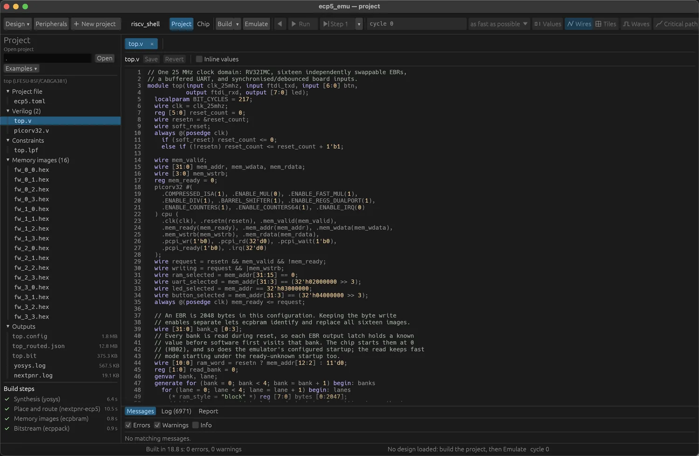
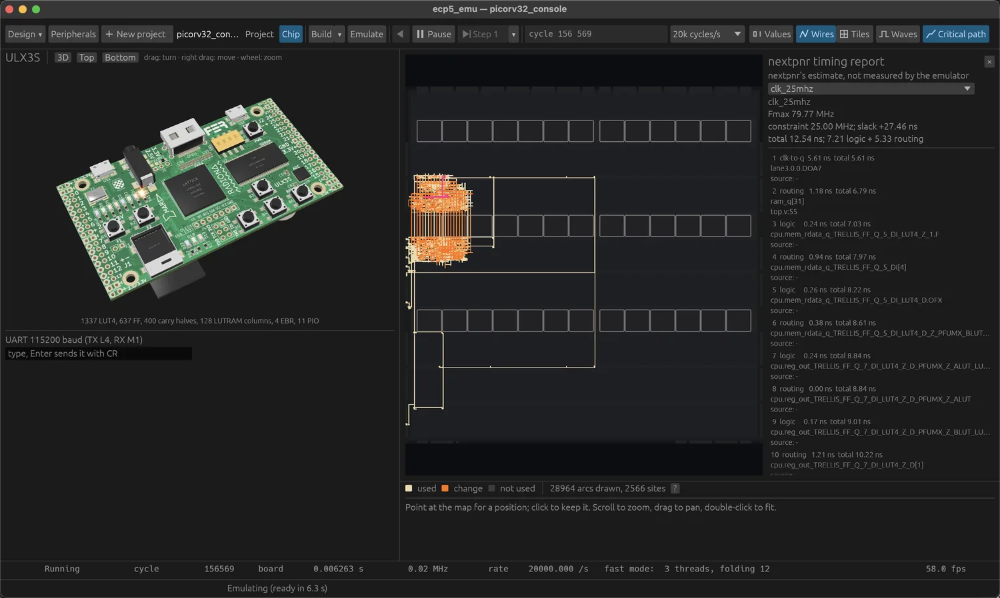
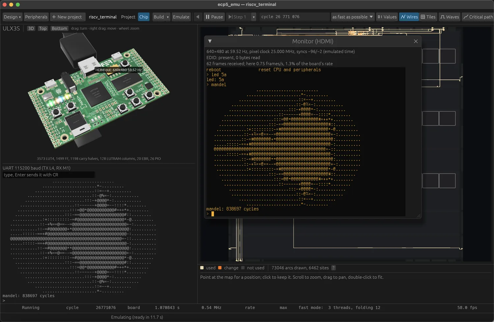
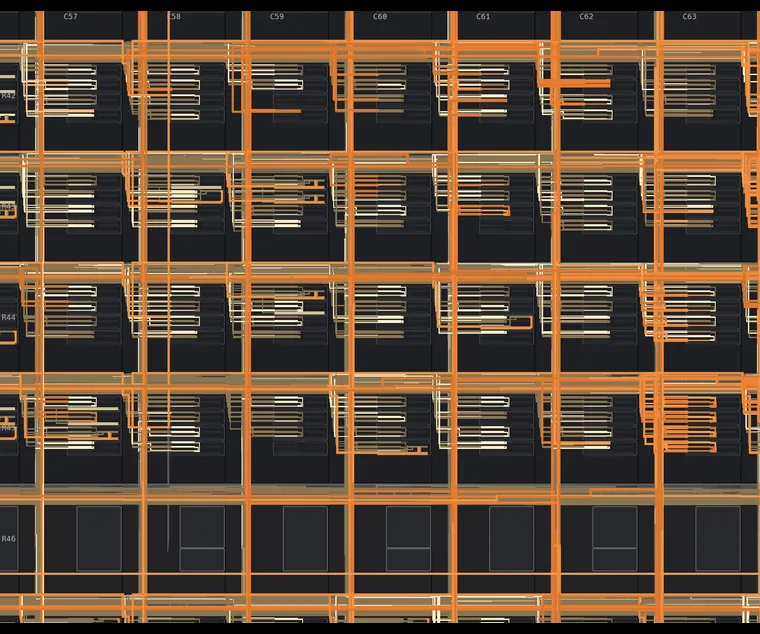
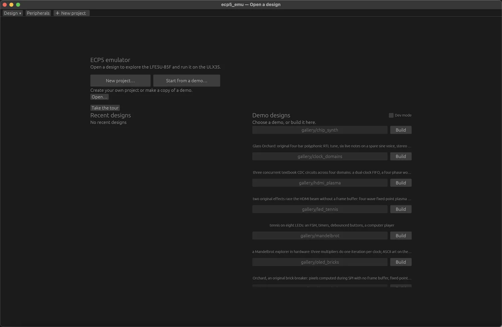
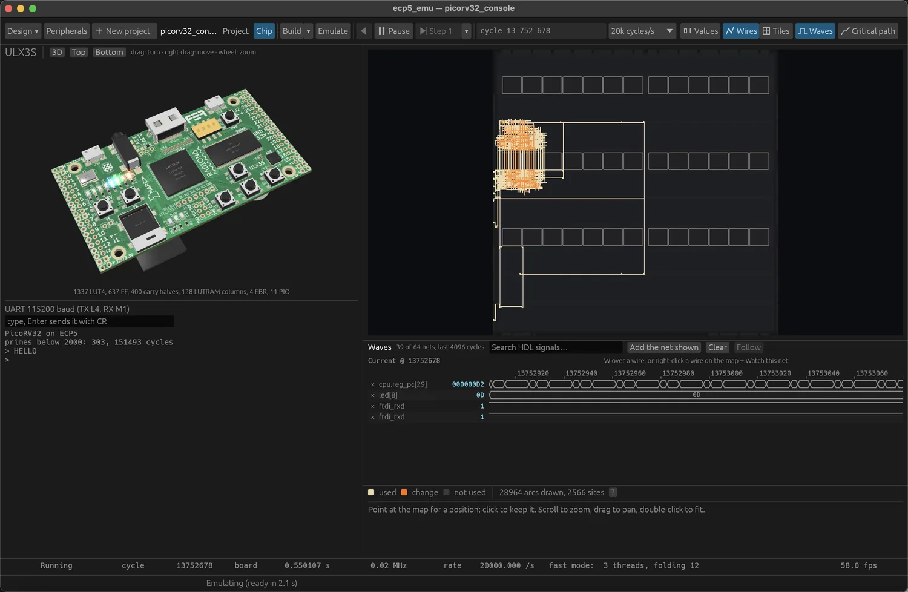
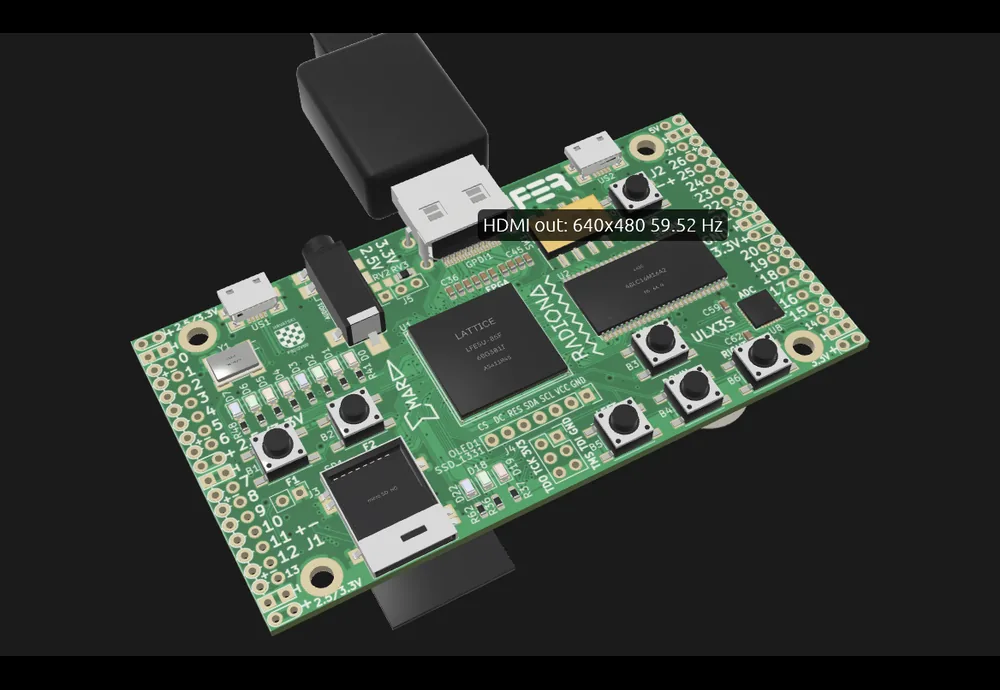

# The window



*The project window on [riscv_shell](../../examples/gallery/riscv_shell/README.md) after a build of
18.8 s with no errors or warnings ([clip of the build](../media/window-project-build.mp4)).*

![The Chip tab shows blinky_cycle at 20 cycles per second, with eight kept nets near the LED pins, lit LEDs on the 3D ULX3S and count[2] in Waves](../media/window-cross-probe.webp)

*Selecting `count` on line 7 of `top.v` in [blinky_cycle](../../examples/ulx3s/blinky_cycle/top.v) kept
its eight nets on the map. The Chip tab runs at 20 cycles per second with `count[2]` in Waves,
showing a period of 8 cycles ([clip](../media/window-cross-probe.mp4)).*



*[picorv32_console](../../examples/ulx3s/README.md) runs in the Chip tab at 20 000 cycles per second
with "Critical path" on. The nextpnr estimate, not measured by the emulator, gives 79.77 MHz,
17 hops and 12.54 ns (7.21 logic + 5.33 routing), with slack +27.46 ns against 25 MHz on
`clk_25mhz`; hop 2 is the block RAM output `ram_q[31]` at `top.v:55`.*



*[riscv_terminal](../../examples/gallery/riscv_terminal/README.md): a PicoRV32 computer whose shell
prints both to the UART console (left) and to an 80 × 30 text screen on HDMI, which the window
decodes from the pads (the Monitor window). `mandel` took 838 697 cycles
([clip](../media/window-riscv-terminal.mp4)).*







*`picorv32_console` at 20 000 cycles per second, watching `cpu.reg_pc`, `led`, `ftdi_rxd` and
`ftdi_txd` in Waves, with the firmware's `HELLO` echo in the console
([clip](../media/window-waves.mp4)).*



*The 3D ULX3S while `riscv_terminal` sends HDMI; the cable's label gives the mode the design drives,
640 × 480 at 59.52 Hz.*

The [media provenance](../media/README.md) records the release package and selected take for each file.

The pictures show the 3D ULX3S model, shipped in the repository through git LFS and included
in release packages, including CI builds. Run `git lfs pull` if a clone has pointer files.
The window uses `ECP5_BOARD_MODEL` first, then a local rebuild in
`out/ulx3s_3d/ulx3s_v3.0.8.glb`, then the shipped model in `assets/ulx3s_3d/`.
[tools/ulx3s_3d](../../tools/ulx3s_3d/README.md) rebuilds it with KiCad 10's `kicad-cli`,
Blender 5.1, `rsvg-convert`, Pillow and numpy.

`ecp5_gui` alone opens on a start screen offering "New project…", "Start from a demo…",
"Take the tour", and recent and demo designs, with a description for each demo. Cmd/Ctrl+Shift+N
opens New project. The two creation actions also come first in Design in plain and project windows.
Starting from a demo makes a copy
([creating a project](projects.md#creating-a-project)). A demo that is not built yet has
a Build button: it builds the demo with Yosys, nextpnr and ecppack (the build `ecp5_emu run` does),
shows the step and seconds in its row, and opens it when done. A demo counts as built with
`target/reference/<name>/top.config` or its own `build/top.config`; selecting it opens it paused,
without rebuilding. A Design menu, a status line (stage, cycle, board time, speed, fast mode's
settings, frames a second) and light and dark themes stay with every view.
`ecp5_gui --project DIR` opens a project in a Quartus-like window: the project's files and an
editor, Build with its steps, messages (each opens its file at its line), log and report
(utilisation, timing per clock), then Emulate. Board loading uses `ecp5_emu load PROJECT`.
Clicking or selecting an HDL name in a project source file keeps its matching nets (driver and
sinks) on the die map and scrolls to them;
"Watch in Waves" adds them to Waves. Right-click a wire or site and choose "Show in source" to open
its assignment, process, declaration or cell location in the project editor, using yosys's `src`
attributes kept by nextpnr in the routed JSON.
A Waves row's menu, for a bit or a collapsed or opened bus, offers "Show on the chip" to keep its
nets, drivers and sinks on the map and bring them into view in the Chip tab, and "Show in source
(file:line)" to return to the project editor (the plain window shows and copies the location). If a
source location is unavailable, the menu says why: no source index yet, no source files found or
matched, or no source line for this net. For VHDL it says:
"Source probing is not available for VHDL yet: the GHDL plugin writes no source locations".
Its Chip tab runs the design in fast mode and shows it:

- the die's whole fabric drawn on the GPU, with the design's wires, LUTs and flip-flops live
  (5.8 million pieces of wire on the full chip); `--net NAME` shows one signal's net whole, from
  its driver to everything it feeds;
- an inspector: a click on a site or a part of a slice shows how it works, its pins with their
  values, its settings and its insides;
- Waves under the map: chosen nets' values after every clock edge, keeping the last 4 096 cycles
  for up to 64 nets; add a net by its HDL name, press W over a wire, right-click a wire and choose
  "Watch this net", or use "Add the net shown" for the net shown on the map;
- "Critical path": nextpnr 0.11.1's timing estimate drawn on the chip, with a clock selector,
  numbered cell outlines and a panel of hop delays and source locations where available;
  the pictured `picorv32_console` build: 79.77 MHz, 17 hops, 12.54 ns, via `ram_q[31]` (`top.v:55`) to
  `picorv32.v:1374`;
- the ULX3S in 3D, built from the board's KiCad design, with the LEDs lit by the design and the
  buttons to press, over a UART console that talks to the design's firmware; DIP levers read by the
  design can be clicked to request a flip, with the requested position shown even while paused; its
  connectors follow datasheet dimensions and KiCad footprints, and an HDMI cable or the OLED module
  is drawn when the design drives it;
- a monitor for what the design sends on HDMI and the OLED's picture, when it drives them, and an
  "ADC (MAX11125)" window with a voltage slider for each input whose pad the design does not drive;
- an "Audio (jack)" window with scopes of the DACs' open-circuit voltages when the design drives
  them, modelled from the schematic, not measured, with no playback;
- the run rate from single cycles to as fast as it goes.

```sh
target/release/ecp5_gui                                  # the start screen
target/release/ecp5_gui --project examples/ulx3s/life    # the project window
target/release/ecp5_emu run examples/ulx3s/life          # the same, built and running
target/release/ecp5_gui --empty                          # the whole fabric, no design
```

The window can be driven by a script and writes a record of what it drew, frame by frame
(`ECP5_GUI_SCRIPT`, `ECP5_GUI_TRACE`; [gui/src/trace.rs](../../gui/src/trace.rs)). Window
measurements are taken from that record.

The opening stages, caches and measured load times are described in [WINDOW.md](../../docs/WINDOW.md).
